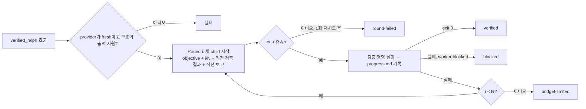

# Week 2 — Build Your Own RALPH (jinmang2)

DSH **Creator mode**로 검증 기반 RALPH Plugin `verified_ralph`를 만들고, 이를 쓰는 **Verified RALPH** Preset을 구성했어요. 같은 Coding 작업 두 개를 공식 `tool-ralph`와 각각 5회씩 돌려 비교했어요. DSH의 다른 반복 방식인 `goal`도 같은 작업으로 함께 쟀어요.

- DeepSeek Harness `0.2.0-rc.2`(Plugin Manager `install_bundle`이 있는 버전), 모델 `deepseek-v4-flash`
- 모든 실행을 **DSH Web host**에서 Preset을 골라 돌렸어요. 같은 Web standard preset을 바탕으로 루프 도구만 달라요.
- 측정 도구: [harness-lab](https://github.com/jinmang2/harness-lab) (`lab run -e dsh-web`, `lab week2`). 모든 모델 호출을 로컬 게이트웨이로 녹화했어요.
- 이 폴더
  - [`plugin/`](plugin/): Plugin 코드와 Preset
  - [`creator-prompt.md`](creator-prompt.md): Creator에게 준 명세
  - [`task/`](task/): 두 작업의 SPEC과 BACKLOG
  - [`results.md`](results.md): 전체 실행의 Round별 기록
  - [`logs/`](logs/): 원문 로그 발췌
  - [`screenshots/`](screenshots/)

## 한눈에 보기

| | 공식 `tool-ralph` | Custom `verified_ralph` | (참고) DSH `goal` |
|---|---|---|---|
| Round마다 | 새 child | 새 child | 같은 대화에 `<goal_round>` |
| 끝을 정하는 쪽 | worker의 보고 | **검증 명령 exit 0** | 모델의 `update_goal complete` |
| 결과 (2작업 × 5회) | 13/13 × 10 | 13/13 × 9 (+ 오염 1회 제외) | 13/13 × 10 |
| 거짓 완료로 끝난 실행 | 0 | 0 | 0 |
| 토큰 (중앙값) | 1.11M / 1.32M | 1.23M / 1.46M (**약 +11%**) | 1.18M / 1.29M |

- 이번 모델과 작업에서는 **세 방식 모두 최종 결과가 같았어요.** 공식 worker가 거짓으로 "다 했다"고 한 적이 한 번도 없어서, 검증이 잡을 일이 없었어요.
- 차이가 드러난 곳은 세 군데예요.
  1. **실패했을 때**: 공식은 child 한 번의 실패(모델 응답 오류)로 루프가 끝났고, 부모 에이전트가 루프를 다시 불러 수습했어요.
  2. **비용**: Custom은 토큰을 약 11% 더 썼어요.
  3. **검증 피드백의 부작용**: 검증 출력의 테스트 이름을 단서로 worker가 **채점 스크립트를 찾으러 간** 실행이 나왔어요. 검증을 쓰는 방식에서만 일어났어요.
- 같은 축을 하나씩 바꾼 재현 실험(아래 4-3절)에서는 worker나 judge가 끝을 정하는 방식이 24회 중 5회 **12/13인 채로 "완료"** 하고 끝났어요. 검증 명령이 끝을 정하는 방식은 0회였어요.

## 1. Custom RALPH 소개: `verified_ralph`

**목적**: 공식 `tool-ralph`는 worker가 "complete"라고 보고하면 그대로 끝나요. README에도 "독립 평가기가 완성을 보증하지 않는다"고 적혀 있어요. `verified_ralph`는 **완료 판단을 worker의 말이 아니라 배포 쪽이 정한 검증 명령의 exit code로** 바꾼 RALPH예요. 나머지(Round마다 새 child, 공유 workspace)는 공식과 같게 두었어요. 그래야 비교했을 때 차이가 "누가 완료를 판단하느냐" 하나에서 나와요.

| 요소 | 구현 |
|---|---|
| 반복 실행 | Plugin 안의 `for` 루프(`index.js:492`)예요. Round마다 `ctx.subagents.start(provider, { prompt, outputSchema })`로 새 child를 하나 띄워요. workflow 엔진이나 공식 `ralph`는 쓰지 않아요 |
| Fresh Context | 시작 전에 provider를 확인해요(`index.js:400`). `inheritsParentContext === false`이고 구조화 출력을 지원해야 하고, 아니면 child를 띄우지 않고 실패해요 |
| 상태 전달 | ① 공유 workspace ② Plugin이 직접 쓰는 `.ralph/progress.md`(Round 번호, worker 보고, 검증 결과) ③ 다음 child 프롬프트에 넣는 직전 검증 결과(exit code + 출력 끝 4,000자)와 직전 worker 보고. 부모 대화는 넘기지 않아요 |
| 종료 조건 | 검증 exit 0 → `verified`. worker `blocked` → `blocked`. 검증 명령이 없을 때만 worker `complete` → `self-reported`. Round 상한 → `budget-limited` |
| 완료 검증 | worker가 `complete`라고 해도 검증이 실패하면 **다음 Round로 넘어가요**. 검증 출력이 다음 child의 입력이 돼요 |
| 실패 처리 | child 실패나 잘못된 보고는 같은 Round에서 1회 재시도하고, 두 번째도 실패하면 `round-failed`예요. 사용자가 취소하면 실행 중인 child를 정리하고 멈춰요. 검증 명령이 타임아웃(기본 120초)을 넘기면 프로세스 트리째 종료해요 |



## 2. Plugin 및 Preset 구성

- **작성**: DSH Web(0.2.0-rc.2) **Creator mode** 세션에 명세를 주고 에이전트가 작성했어요. 명세는 [`creator-prompt.md`](creator-prompt.md)에 있어요. 제가 고친 코드는 없어요. Creator가 마지막에 스스로 고친 한 줄(child 프롬프트에 "이 Round 안에서 verified_ralph를 다시 부르지 말 것")만 있어요.
- **코드**: [`plugin/`](plugin/)
  - `index.js`: Host Plugin, 612줄
  - `package.json`: `dsh.bundle.patch`
  - `cordis.patch.yml`: Preset 선언
  - `README.md`, `locale/`, `icon.svg`
- **설치**: Creator 세션에서 `plugin_manager install_bundle`을 실행했어요(승인 필요). 그러면 Web 프로필 `package.json`의 `dsh.profile.bundles`에 `@local/verified-ralph`(link)가 추가돼요. pnpm이 PATH에 없으면 ENOENT로 실패해서, Web을 PATH에 pnpm을 넣고 다시 띄웠어요.
- **Preset** (`cordis.patch.yml`): id `verified-ralph`, 이름 "Verified RALPH"예요. 공식 `standard` preset 행을 그대로 복사하고(`tool-ralph`는 꺼진 채로), 행 하나만 더했어요. Plugin은 **이 Preset 안에서만** 마운트되고 전역 도구 목록에는 없어요.

```yaml
- id: verified-ralph
  name: '@local/verified-ralph'
  config:
    maxRounds: 5
    verifyCommand: 'python3 <harness-lab>/tasks/checks/week2_verify.py .'
```

- **검증 명령**은 배포 설정이라 작업마다 바꾸지 않아요. `week2_verify.py` 하나가 workspace의 SPEC 제목을 보고 그 작업의 수락 테스트를 돌려요.
- **확인**: 새 세션의 모드 메뉴에 "Verified RALPH"가 보여요([스크린샷](screenshots/preset-menu.png)). Creator가 `Config.listConfigs`로 두 가지를 확인했어요. `preset-verified-ralph`가 등록됐고, standard preset 에이전트의 도구 목록에는 `verified_ralph`가 없어요.
- **공식 쪽 Preset**: 공식 `tool-ralph`도 같은 standard preset을 복사한 "ralph" preset으로 돌렸어요. 다른 점은 `tool-ralph` 행을 켜고 `maxRounds: 5`로 둔 것뿐이에요. goal은 standard preset 그대로이고, goal 서비스의 기본 상한만 5로 맞췄어요.

## 3. 실행 기록

### 작업 두 개

둘 다 작은 Python 모듈을 [SPEC](task/)의 규칙 12개와 round trip 규칙에 맞게 구현하는 작업이에요. SPEC은 BACKLOG 4항목으로 나뉘어 있어요. 지시문은 원래 Ralph의 "한 Round에 한 항목" 방식이에요.

- `durations-backlog`: 시간 길이(`1h30m`, `PT1H30M`) parse/format
- `sizes-backlog`: 바이트 크기(`1.5 KiB`) parse/format. 대소문자 구분, 밑줄 표기, half-even 반올림, 단위 넘김처럼 "다 했다고 믿기 쉬운" 규칙을 일부러 넣었어요.

> Run a Ralph loop with at most 5 rounds toward this objective: Implement sizes.py in this workspace so that it satisfies every rule in SPEC.md, working through BACKLOG.md. Each round, take the first unchecked BACKLOG.md item, implement and test only that item, then check it off. The starter tests in tests/ cover only part of the spec. Use only the Python standard library and keep the public API (parse, format) unchanged.

- goal은 같은 문장을 `/goal <objective>`로 넣었어요.
- **시작 상태**: `parse`/`format`이 `NotImplementedError`인 stub이에요. 공개 테스트는 SPEC의 일부만 다뤄요.
- **채점**: **workspace 밖**에 있는 수락 테스트 13개(규칙마다 1개)로 해요. Custom의 검증 명령과 최종 채점이 같은 스크립트를 써요. 공식과 goal 실행에서는 채점에만 써요.
- **조건**
  - 모델 `deepseek-v4-flash`(thinking, 같은 설정), 같은 지시문, 같은 fixture 복사본, 최대 5 Round
  - 실행마다 DSH Web host를 따로 띄우고 각 5회
  - workspace는 목록을 볼 수 없는 임시 폴더에 만들었어요. 다른 실행이나 채점 파일이 보이지 않게 하려는 거예요.

### Web에서 Verified RALPH Preset으로 실행 (Task 02/03 증거)

새 세션에서 모드를 **Verified RALPH**로 고르고 지시문을 그대로 보냈어요. 에이전트가 `verified_ralph`를 한 번 호출했고, Plugin이 child 4개를 차례로 띄웠어요.


| Round | child가 한 일 (첫 미완료 BACKLOG 항목) | Plugin의 검증 결과 |
|---:|---|---|
| 1 | compact parse (규칙 1, 2, 3, 5, 6, 9, 10) | exit 1, 7/13 |
| 2 | 소수와 부호 (규칙 4, 7) | exit 1, 9/13 |
| 3 | ISO 8601 parse (규칙 8) | exit 1, 10/13 |
| 4 | format 두 형식 + round trip (규칙 11, 12) | **exit 0, 13/13 → `verified`** |

- **이전 상태가 넘어간 방식**: child는 매번 빈 대화로 시작했어요. `BACKLOG.md`의 체크 표시와 `.ralph/progress.md`를 먼저 읽고 다음 항목을 골랐어요. 프롬프트에는 직전 검증 출력이 들어갔어요. 어떤 규칙이 왜 실패했는지 담긴 JSON이에요. [progress.md 전문](logs/web/web-preset-progress.md)
- **언제, 왜 끝났나**: Round 4 뒤에 검증 명령이 exit 0을 돌려줘서 끝났어요. worker의 `complete` 보고 때문이 아니에요.
- **화면**: [결과](screenshots/web-run.png), [Round 표](screenshots/web-rounds.png), [Trajectory](screenshots/web-trajectory.png), [Preset 메뉴](screenshots/preset-menu.png)

### 반복 실행 결과 (DSH Web, 각 5회)

| 작업 | 방식 | 수락 테스트 | Round | 종료 | 토큰 (중앙값) | 도구 호출 | 시간 |
|---|---|---|---|---|---:|---:|---:|
| durations | 공식 `tool-ralph` | 13/13 × 5 | 4, 4, 4, 4 (루프 2번), 4 | worker complete × 5 | 1,106,797 | 84 | 252초 |
| durations | Custom `verified_ralph` | 13/13 × 4 (+오염 1) | 4, 4, 4, 4 | verified × 4 | 1,226,064 | 84.5 | 248초 |
| durations | DSH `goal` | 13/13 × 5 | 4, 4, 4, 4, 4 | complete × 5 | 1,184,028 | 45 | 176초 |
| sizes | 공식 `tool-ralph` | 13/13 × 5 | 4, 4, 4, 4, 4 | worker complete × 5 | 1,315,738 | 86 | 263초 |
| sizes | Custom `verified_ralph` | 13/13 × 5 | 4, 4, 4, **1**, 4 | verified × 5 | 1,457,273 | 90 | 299초 |
| sizes | DSH `goal` | 13/13 × 5 | 4, 4, 4, 4, 4 | complete × 5 | 1,285,718 | 47 | 168초 |

- 토큰은 Round child를 포함한 모든 모델 호출의 합이에요. 입력은 캐시를 포함하고, 그중 96%가 캐시 적중이에요.
- Round별 worker 보고, 검증 exit, 마지막 결과 문구는 [results.md](results.md)에 다 있어요.

**Round마다 무엇이 넘어갔나**
- **공식**: 직전 worker가 쓴 보고서(status/summary/evidence/nextSteps)만 넘어가요. [공식 sizes #1의 Round별 보고서](logs/web/official-sizes-1-reports.md)
- **Custom**: 거기에 더해 Plugin이 쓴 progress 파일과 검증 출력이 넘어가요. sizes #3의 progress 파일을 보면 Round마다 통과 수가 7 → 8 → 12 → 13으로 올라갔어요. Round 3 뒤에는 "rule 11: carry"만 실패로 남았고, 다음 child는 그 규칙으로 바로 갔어요. [Custom sizes #3 progress.md](logs/web/custom-sizes-3-progress.md)

**눈여겨볼 실행 1: 공식 durations #4. Round가 실패한 뒤 부모가 수습했어요**
- Round 3 child가 모델 응답 오류(`tool input is invalid JSON`)로 보고 없이 끝났어요.
- `tool-ralph`는 재시도하지 않아서 루프가 `Ralph round 3 child failed…`로 끝나고, 오류가 부모에게 돌아갔어요.
- 부모 에이전트는 workspace와 테스트를 확인한 뒤 **`ralph`를 새로 불렀어요.** 새 루프의 Round 1이 남은 항목을 끝냈어요.
- 구조가 아니라 부모 모델의 판단으로 살아난 거예요. [로그](logs/web/official-durations-4-retry.md)

**눈여겨볼 실행 2: Custom sizes #4. 한 Round에 다 끝냈어요**
- Round 1 worker가 "한 Round에 한 항목" 지시를 어기고 4항목을 한꺼번에 구현했어요. 검증이 바로 통과해서 1 Round로 끝났어요.
- Custom은 worker가 지시를 어겨도 결과만 맞으면 끝나요.

## 4. 공식 `tool-ralph`와 비교

### 4-1. 비교 표

| 비교 항목 | Custom `verified_ralph` | 공식 `tool-ralph` |
|---|---|---|
| 반복 실행 제어 방식 | Host Plugin 안의 `for` 루프가 직접 `ctx.subagents.start`를 불러요 | 고정 workflow 스크립트가 `ctx.workflowEngine` 위에서 Round를 돌려요. 모델은 objective만 넣어요 |
| 새 Context 생성 여부 | 예. Round마다 새 child예요. 시작 전에 provider가 부모 context를 물려받지 않는지 검사해요 | 예. Round마다 새 child예요 |
| 이전 Round 상태 전달 방식 | 공유 workspace + **Plugin이 쓰는** `.ralph/progress.md` + **직전 검증 출력**(끝 4,000자) + 직전 worker 보고 | 공유 workspace + 직전 worker 보고서(status/summary/evidence/nextSteps, 최대 16KB) |
| 실행된 Round 수 (각 5회) | durations 4, 4, 4, 4 / sizes 4, 4, 4, 1, 4 | durations 4, 4, 4, 4(루프 2번), 4 / sizes 4 × 5 |
| 완료 및 종료 조건 | **검증 명령 exit 0**이면 `verified`예요. worker `complete`는 검증이 실패하면 무시하고 다음 Round로 가요. 그 밖에 `blocked`, Round 상한(`budget-limited`) | worker의 `complete` 보고. 그 밖에 `blocked`, Round 상한 |
| 오류·진행 불가 처리 | child 실패나 잘못된 보고는 1회 재시도하고, 다시 실패하면 `round-failed`예요. 취소하면 child를 정리해요. 검증 타임아웃이 지나면 프로세스 트리를 종료해요 | child 실패나 잘못된 보고는 재시도 없이 루프 실패예요. 마지막 handoff를 오류에 담아 부모에게 돌려줘요 |
| Tool 호출 / Token (중앙값) | 도구 84.5 / 90회, 1.23M / 1.46M 토큰 | 도구 84 / 86회, 1.11M / 1.32M 토큰 |
| 최종 결과 | 13/13 × 9. 1회는 채점 자료를 읽어서 제외했어요 | 13/13 × 10. 거짓 완료 0회 |
| 발견한 한계 | 아래 5절 | 완료가 worker의 말에 달려 있어요. child 한 번의 실패로 루프가 멈춰요(이번에는 부모가 다시 불러 수습) |

### 4-2. 구조 차이가 만든 동작 차이

1. **누가 끝을 정하나.**
   - 공식은 worker가, Custom은 배포 쪽 명령이 끝을 정해요.
   - 이번 10회에서는 공식 worker가 한 번도 거짓으로 "다 했다"고 하지 않았어요. 그래서 최종 결과는 같았어요.
   - 다만 이건 worker가 매번 정직했기 때문이지, 구조가 막아 준 게 아니에요. 이전 headless 측정에서는 Custom worker가 12/13 상태로 `complete`라고 했고, 검증이 이를 잡아 다음 Round에서 고친 적이 있어요. [로그](logs/headless/custom-1-progress.md)
2. **다음 Round가 받는 정보.**
   - 공식 child는 이전 worker의 자기 보고를 받아요. Custom child는 그것에 더해 **실패한 규칙 목록**을 받아요.
   - 그래서 Custom child는 남은 실패로 바로 가요. 반대로 그 목록이 단서가 돼서 채점 스크립트를 찾으러 가기도 했어요(5절).
3. **실패에 대한 태도.**
   - 공식은 재시도가 없어서 모델 응답 오류 한 번에 루프가 끝났어요. Custom은 같은 Round를 한 번 더 시도해요.
   - 공식에서도 부모가 루프를 다시 부르면서 사실상 재시도가 일어났어요. 그러니 차이는 "재시도를 누가 하나"(Plugin이냐 부모 모델이냐)예요.
4. **비용.**
   - Custom은 토큰을 약 11% 더 썼어요.
   - 검증 명령 자체는 1초 안에 끝나요. 늘어난 토큰은 child 프롬프트에 붙는 검증 출력과 progress 파일 때문으로 보여요.
5. **같은 세션에서 반복하는 goal과 비교하면.**
   - goal도 10회 모두 13/13, 4 Round였어요.
   - 도구 호출은 절반 정도(45 vs 84)이고, 시간도 30~35% 짧았어요. 같은 대화를 이어 가니 Round마다 SPEC과 코드를 다시 읽을 필요가 없어서예요.
   - 대신 대화가 길어질수록 Context가 쌓여요. 이번처럼 4 Round짜리 작업에서는 그 비용이 드러나지 않았어요.

### 4-3. 참고: 축을 하나씩 바꿔 본 재현 실험 (각 3회)

harness-lab에서 LangChain/deepagents로 반복 방식을 직접 만들어, 같은 두 작업을 돌렸어요. 두 축을 하나씩 바꿨어요.
- **Context**: 새 child / 같은 대화 / 같은 대화 + Round마다 비우기
- **끝내는 쪽**: worker / judge / 검증 명령

엔진이 달라서(DSH는 Messages API, 이쪽은 chat/completions) DSH 수치와 직접 비교하지 않고 경향만 봐요.

| 방식 | Context | 끝내는 쪽 | 수락 테스트 (2작업 × 3회) | 거짓 완료로 끝남 | 토큰 (중앙값) |
|---|---|---|---|---:|---:|
| fresh (공식 재현) | 새 child | worker 보고 | 13 × 5, **12/13** × 1 | 1 | 1.20–1.47M |
| verified (Custom 재현) | 새 child | 검증 명령 | 13 × 6 | 0 | 1.13–1.16M |
| goal (DSH goal 재현) | 같은 대화 | 모델의 complete | 13 × 5, **12/13** × 1 | 1 | 1.00–1.20M |
| judge | 같은 대화 | 같은 모델의 별도 judge 호출 | 13 × 5, **12/13** × 1 | 1 | 0.78–0.81M |
| check | 같은 대화 | 검증 명령 | 13 × 5 (+오염 1) | 0 | 0.69–0.75M |
| reset | 같은 대화, Round마다 대화를 비우고 handoff만 남김 | worker | 13 × 4, **12/13** × 2 | 2 | 0.77–0.88M |

- **끝을 worker나 judge가 정하는 방식**(fresh, goal, judge, reset)은 24회 중 5회가 12/13인 채로 "완료"로 끝났어요. 놓친 규칙은 모두 "다 했다고 믿기 쉬운" 것이었어요: 부호 하나(rule 7), 소수(rule 4), 단위 넘김(rule 11).
- **검증 명령이 끝을 정하는 방식**(verified, check)은 11회 모두 13/13이었어요.
- **같은 대화 방식(judge, check)은 대부분 1 Round로 끝났어요.**
  - Round 경계가 대화 안에 없으니 worker가 첫 턴에 4항목을 다 해 버려요. "한 Round에 한 항목" 지시가 힘을 잃어요.
  - 대신 토큰이 가장 적었어요.
- fresh가 DSH 공식과 달리 거짓 완료를 냈어요. 엔진과 prompt 처리의 차이 때문으로 보고, 재현이 원본과 완전히 같지 않다는 신호로 읽어요.

## 5. 결론

**잘 동작한 점**
- 공식 `tool-ralph`를 쓰지 않고 Plugin 안의 루프로 반복 실행, 상태 전달, 종료 조건을 모두 직접 제어했어요. Preset을 고른 Web 세션에서 child가 Round마다 새로 떴어요.
- 끝을 검증 명령에 맡기니 "worker가 정직한가"와 상관없이 결과가 정해져요. 재현 실험에서 worker/judge 방식은 거짓 완료가 5회 나왔고, 검증 방식은 0회였어요.
- 1회 재시도가 있어서, 공식 구조를 멈춰 세운 "child가 보고 없이 끝남"에도 루프가 버텨요.

**어려웠던 점**
- **설치 경로.** Plugin Manager가 PATH에서 `pnpm`을 찾는데, 이 PC에는 PATH에 없어서 첫 설치가 ENOENT로 실패했어요. Creator가 `~/.local/bin`에 symlink를 만들겠다고 했지만 거절하고, Web 프로세스에만 PATH를 넣어 다시 띄웠어요.
- **headless로는 비교가 안 돼요.** 0.2.0-rc.2 headless 실행기는 Preset을 조립하지 않아요. 첫 idle에서 끝나서 goal Round도 돌지 않아요. 그래서 실행마다 Web host를 띄우고, 브라우저가 쓰는 RPC로 세션을 만들어 Preset을 고르게 했어요.
- **workspace 격리.** 처음에는 workspace를 실행 결과 폴더 아래에 뒀어요. 그랬더니 child가 상위 폴더로 올라가 옆 실행의 구현과 채점 스크립트를 읽었어요. 그래서 workspace를 목록을 볼 수 없는 임시 폴더에 두고, 도구 호출마다 workspace 밖 경로를 기록해 채점 자료에 닿은 실행을 뺐어요.

**발견한 한계와 개선할 부분**
- **검증 피드백이 "시험지 찾기"를 부추겨요.**
  - Custom durations #4의 Round 4 worker는 검증 출력의 테스트 이름(`test_r04_decimals`)으로 검색을 시작했어요. 단서는 DSH 시스템 프롬프트가 알려 준 런타임 위치였고, 그 상위 폴더에서 수락 테스트와 정답 코드를 찾아 읽었어요.
  - 재현 실험의 check 방식에서도 같은 일이 한 번 있었어요.
  - 검증을 쓰는 22회 중 2회 일어났고, 검증이 없는 44회에서는 0회였어요.
  - 검증 명령과 채점 자료는 worker가 읽을 수 없는 곳에 두거나, 피드백에서 테스트 이름과 경로를 걸러야 해요. sandbox의 읽기 범위를 workspace로 묶는 게 가장 확실해요.
- **progress 파일을 worker도 고칠 수 있어요.** Plugin이 쓰는 `.ralph/progress.md`에 worker도 같은 형식으로 적어서, `## Round 3`이 두 번 생겼어요. 검증 결과 기록이 worker 손에 있다는 뜻이에요. Plugin 쪽 기록은 workspace 밖(또는 세션 상태)에 두는 게 맞아요.
- **검증은 "끝"만 판단해요.** worker가 지시를 어기고 한 Round에 다 해도 결과만 맞으면 끝나요(sizes #4). 과정까지 보려면 항목별 검증이 필요해요.
- **비용**: 검증 출력 4,000자와 progress 파일이 매 Round 프롬프트에 붙어 토큰이 약 11% 늘었어요. 실패한 규칙만 요약해서 넘기면 줄일 수 있어요.
- **환경변수**: 검증 명령에 Host의 환경변수가 그대로 넘어가요. 지금 검증 스크립트는 환경변수를 읽지 않지만, 임의 명령을 받는 배포라면 넘길 변수를 골라야 해요.
- 검증 명령의 경로가 Preset 설정에 절대 경로로 박혀 있어요. 배포마다 바꿔야 해요.

---

### 재현

```bash
# harness-lab
uv run lab dsh-install --version 0.2.0-rc.2
uv run lab dsh-web-setup            # Web 프로필 + plugin/ 번들 링크 (pnpm 필요)
uv run lab run -T tasks/week2.yaml -t durations-backlog -t sizes-backlog -e dsh-web -H ralph-official,ralph-custom -n 5
uv run lab run -T tasks/week2.yaml -t durations-backlog-goal -t sizes-backlog-goal -e dsh-web -H goal -n 5
uv run lab week2 runs/<batch>... --id <GitHub-ID>
```

- API key, credential, 세션 로그 원문은 넣지 않았어요. 경로는 `<harness-lab>`, `<workspace>`, `<tmp>`로 바꿨어요.
- [`logs/headless/`](logs/headless/)는 Web 엔진을 만들기 전, headless + patch로 3회씩 잰 이전 기록이에요.
