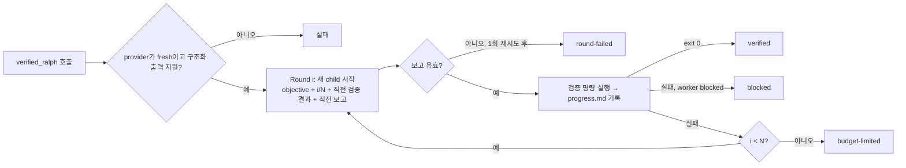
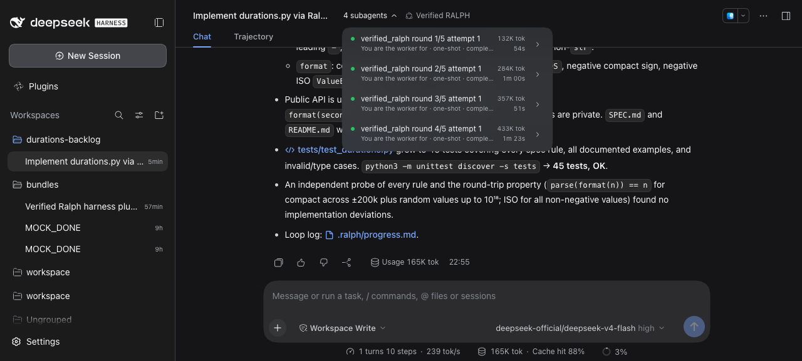

# Week 2 — Build Your Own RALPH (jinmang2)

DSH **Creator mode**로 검증 기반 RALPH Plugin `verified_ralph`를 만들고, 이를 쓰는 **Verified RALPH** Preset을 구성했어요. Coding 작업 세 개를 공식 `tool-ralph`와 각각 5회씩 돌려 비교했어요. 비교가 공정한지 따지다가 Custom의 변형 하나(검증과 채점을 분리)를 더했고, DSH의 다른 반복 방식인 `goal`도 함께 쟀어요. 그 변형에서 드러난 종료 규칙의 구멍을 고친 **v2**도 같은 조건으로 다시 쟀어요(4-7절). 마지막으로, Custom이 왜 공식을 넘지 못하는지를 새 실험 없이 기존 기록만으로 뜯어봤어요(4-8절).

- DeepSeek Harness `0.2.0-rc.2`(Plugin Manager `install_bundle`이 있는 버전), 모델 `deepseek-v4-flash`
- 모든 실행을 **DSH Web host**에서 Preset을 골라 돌렸어요. 같은 Web standard preset을 바탕으로 루프 도구만 달라요.
- 측정 도구: [harness-lab](https://github.com/jinmang2/harness-lab) (`lab run -e dsh-web`, `lab week2`). 모든 모델 호출을 로컬 게이트웨이로 녹화했어요.
- 이 폴더
  - [`plugin/`](plugin/): Plugin 코드와 Preset
  - [`creator-prompt.md`](creator-prompt.md): Creator에게 준 명세
  - [`task/`](task/): 세 작업의 SPEC과 BACKLOG
  - [`results.md`](results.md): 전체 실행의 Round별 기록
  - [`logs/`](logs/): 원문 로그 발췌
  - [`screenshots/`](screenshots/)

## 한눈에 보기

| | 공식 `tool-ralph` | Custom `verified_ralph` | Custom, 검증 = workspace 테스트 | **Custom v2**, 검증 = workspace 테스트 | (참고) DSH `goal` |
|---|---|---|---|---|---|
| Round마다 | 새 child | 새 child | 새 child | 새 child | 같은 대화에 `<goal_round>` |
| 끝을 정하는 쪽 | worker의 보고 | 검증 명령 = **채점용 수락 테스트** | 검증 명령 = **worker가 쓴 테스트** | worker 테스트 통과 **그리고** worker `complete` | 모델의 `update_goal complete` |
| 최종 workspace 만점 (3작업 × 5회) | **15 / 15** | **14 / 14** (+ 오염 1) | **13 / 14** (+ 오염 1) | **13 / 14** | 10 / 10 (2작업) |
| **루프가 끝난 순간** 만점 | **15 / 15** | **14 / 14** | **9 / 14** | **13 / 14** | 10 / 10 |
| 덜 된 채 "완료"로 끝난 루프 | 0 | 0 | **5** (그중 4회는 부모 모델이 루프 뒤에 고침) | 1 (부모도 못 고침) | 0 |
| 숨은 버그 (차분 테스트, 4-5절) | 1회 | 0 | 0 | 1회 | 0 |
| 비용 중앙값, $/실행 (durations / sizes / versions) | 0.085 / 0.089 / 0.174 | 0.083 / 0.103 / 0.160 | 0.084 / 0.084 / 0.185 | 0.072 / 0.120 / 0.215 | 0.058 / 0.055 / — |
| 출력 토큰 중앙값 (같은 순서) | 51k / 55k / 115k | 48k / 63k / 102k | 49k / 52k / 119k | 42k / 75k / 144k | 37k / 36k / — |

- versions는 공식과 Custom 5회, workspace 테스트 Custom v2는 같은 조건의 v1과 맞추려고 4회(#2–#5)예요.
- 비용은 DeepSeek 공식 단가(피크 시간대)로 계산했어요. 돈의 약 75%가 출력 토큰이라, 비용과 시간은 출력 토큰으로 비교해요. 캐시를 포함한 "전체 토큰"은 95%가 거의 공짜인 캐시 입력이라 비교 지표로 맞지 않았어요(4-8절).

### 그래서 Custom이 얼마나 나아졌나

| 기준 | 판정 | 근거 |
|---|---|---|
| 최종 품질 | **나아지지 않았어요** | 공식이 이미 15/15 만점이에요. 어려운 작업(versions)을 더해도 천장이었어요 |
| 거짓 완료 방지 | **이번 조건에선 막을 게 없었어요** | 공식 worker가 15회 내내 정직했어요. 공정한 조건(검증과 채점 분리)의 Custom은 오히려 루프 5회가 덜 된 채 verified로 끝났어요 |
| 루프 자체의 신뢰도 | **v1은 나빠졌고, v2에서 공식 수준으로 돌아왔어요 (공정한 조건)** | v1은 종료 규칙이 "검증 통과"만 봐서, worker가 "아직 남았다(continue)"고 해도 멈췄어요(루프 끝 9/14). 규칙만 고친 v2는 13/14예요. 공식 15/15와의 차이는 우연 범위예요(p ≈ 0.48). 4-5절, 4-7절 |
| 숨은 품질 | **차이 없음** | 정답 코드와 무작위 입력 수천 개를 비교하니 69회 중 숨은 버그는 공식 1회, v2 1회였어요. 방식 차이라기엔 너무 적어요 |
| 과정 지키기 ("한 Round에 한 항목") | **나빠졌어요** | 공식 14/15, goal 10/10, Custom 12/14, workspace 테스트 Custom 9/14, v2 12/14 |
| 옵저버빌리티 | **나아졌어요** | Round마다 검증 exit와 점수가 남아서 "어디까지 됐나"와 "worker 말이 맞나"를 기록만으로 알 수 있어요. 4-6절 |
| 비용 | **일관된 차이 없음** | 공식 대비 실행당 $가 작업마다 −2%, +16%, −8%(수락 테스트 검증). workspace 테스트 검증은 −1%, −6%, +6%. v2는 −15%, +35%, +24%. 같은 방식이어도 실행마다 비용이 17%쯤 흔들려서, 5회로는 20%보다 작은 차이를 가려낼 수 없어요(4-8절). goal은 공식보다 32~38% 쌌어요 |
| 실패에 대한 견고성 | **비교 불가** | 공식은 15회 중 1회 Round가 죽었고 부모가 루프를 다시 불러 수습했어요. Custom은 Round가 죽은 적이 없어서 재시도가 쓰이지 않았어요 |
| 부작용 | **새로 생김** | Custom 계열에서만 worker가 채점 스크립트를 찾아 읽은 실행이 나왔어요(30회 중 2회, 공식·goal 25회 중 0회) |

- **한 줄 요약**: "끝을 worker의 말 대신 검증으로 정한다"는 설계는 **worker가 틀릴 때만** 이득이 있어요. 이번 모델과 작업에서는 공식 worker가 틀리지 않아서 이득이 측정되지 않았어요. 그리고 검증이 **무엇을 보느냐**가 중요하다는 게 드러났어요.
  - 채점과 같은 테스트로 검증하면 결과는 좋지만, 그건 채점표를 보면서 고친 결과예요(공정하지 않아요).
  - worker가 쓴 테스트로 검증하면 worker가 SPEC을 잘못 이해한 부분까지 "통과"시켜요. 테스트가 덜 쓰인 상태에서도 통과해서, BACKLOG가 남았는데 루프가 끝나기도 했어요.
- **종료 규칙을 고친 v2**: "검증 통과 + worker `complete`"일 때만 끝내게 바꾸자, 공정한 조건에서 루프가 끝난 순간 만점이 9/14에서 13/14로 올랐어요. v1이었다면 일찍 끝났을 실행이 14회 중 9회였고, v2는 그 실행들을 모두 worker가 `complete`라고 할 때까지 이어 갔어요. 공식을 넘어서지는 못했어요(4-7절).
- **왜 넘지 못하나**: Web 실행 전체에서 "worker는 `complete`인데 검증이 실패해서 루프가 이어진" Round가 **한 번도 없었어요.** Custom이 공식과 다르게 행동할 유일한 지점이 한 번도 쓰이지 않은 거예요. 같은 모델이 같은 일을 하니 비용도 같아요. 실제로 틀린 채 끝난 실행은 모두 worker와 worker 테스트가 **같이** 틀린 경우였고, 이건 worker와 독립된 기준만 잡을 수 있어요(4-8절).
- **성공률만 보면 놓치는 것**: 공식이 만점인 이유의 일부는 루프 밖에 있었어요. `tool-ralph`는 부모 모델에게 "완료는 worker 보고일 뿐"이라고 알려 주고, 부모는 루프가 끝난 뒤 15회 모두 직접 테스트를 돌려 확인했어요. 최종 workspace는 "루프 + 부모의 검토"의 결과예요. 그래서 루프가 끝난 순간의 상태를 따로 복원해 채점했어요(4-5절).
- 반복 실행 방식 자체로 보면 차이가 분명했어요.
  1. **끝을 정하는 쪽**: 공식은 worker 보고, Custom은 검증 exit code
  2. **다음 Round로 넘기는 것**: 공식은 보고서 하나, Custom은 보고서 + 검증 결과 + progress 파일
  3. **실패 처리**: 공식은 재시도 없이 루프 종료, Custom은 같은 Round 1회 재시도

## 1. Custom RALPH 소개: `verified_ralph`

**목적**: 공식 `tool-ralph`는 worker가 "complete"라고 보고하면 그대로 끝나요. README에도 "독립 평가기가 완성을 보증하지 않는다"고 적혀 있어요. `verified_ralph`는 **완료 판단을 worker의 말이 아니라 배포 쪽이 정한 검증 명령의 exit code로** 바꾼 RALPH예요. 나머지(Round마다 새 child, 공유 workspace)는 공식과 같게 두었어요. 그래야 비교했을 때 차이가 "누가 완료를 판단하느냐" 하나에서 나와요.

| 요소 | 구현 |
|---|---|
| 반복 실행 | Plugin 안의 `for` 루프(`index.js:568`)예요. Round마다 `ctx.subagents.start(provider, { prompt, outputSchema })`로 새 child를 하나 띄워요. workflow 엔진이나 공식 `ralph`는 쓰지 않아요 |
| Fresh Context | 시작 전에 provider를 확인해요(`index.js:462`). `inheritsParentContext === false`이고 구조화 출력을 지원해야 하고, 아니면 child를 띄우지 않고 실패해요 |
| 상태 전달 | ① 공유 workspace ② Plugin이 직접 쓰는 `.ralph/progress.md`(Round 번호, worker 보고, 검증 결과) ③ 다음 child 프롬프트에 넣는 직전 검증 결과(exit code + 출력 끝 4,000자)와 직전 worker 보고. 부모 대화는 넘기지 않아요 |
| 종료 조건 | 검증 exit 0 → `verified`(v2 설정 `stopWhen: verifier-and-worker`에서는 같은 Round worker가 `complete`일 때만). worker `blocked` → `blocked`. 검증 명령이 없을 때만 worker `complete` → `self-reported`. Round 상한 → `budget-limited` |
| 완료 검증 | worker가 `complete`라고 해도 검증이 실패하면 **다음 Round로 넘어가요**. 검증 출력이 다음 child의 입력이 돼요 |
| 실패 처리 | child 실패나 잘못된 보고는 같은 Round에서 1회 재시도하고, 두 번째도 실패하면 `round-failed`예요. 사용자가 취소하면 실행 중인 child를 정리하고 멈춰요. 검증 명령이 타임아웃(기본 120초)을 넘기면 프로세스 트리째 종료해요 |



## 2. Plugin 및 Preset 구성

- **작성**: DSH Web(0.2.0-rc.2) **Creator mode** 세션에 명세를 주고 에이전트가 작성했어요. 명세는 [`creator-prompt.md`](creator-prompt.md)에 있어요. 1~4절의 측정은 Creator가 쓴 원본 그대로예요. 원본 안의 수정은 Creator가 마지막에 스스로 고친 한 줄(child 프롬프트에 "이 Round 안에서 verified_ralph를 다시 부르지 말 것")뿐이에요. 측정 뒤에 설정 옵션을 더했어요. 종료 규칙 `stopWhen`(4-7절)과 worker 설정 `workerTools`, `workerProtocol`, `workerEffort`(4-8절)예요. 모두 기본값이 원본 동작이라, 원래 Preset은 그대로 같은 루프를 돌려요.
- **코드**: [`plugin/`](plugin/)
  - `index.js`: Host Plugin. Creator가 쓴 원본은 612줄이고, 측정 뒤 설정 옵션을 더해 지금 691줄이에요
  - `package.json`: `dsh.bundle.patch`
  - `cordis.patch.yml`: Preset 선언
  - `README.md`, `locale/`, `icon.svg`
- **설치**: Creator 세션에서 `plugin_manager install_bundle`을 실행했어요(승인 필요). 그러면 Web 프로필 `package.json`의 `dsh.profile.bundles`에 `@local/verified-ralph`(link)가 추가돼요. pnpm이 PATH에 없으면 ENOENT로 실패해서, Web을 PATH에 pnpm을 넣고 다시 띄웠어요.
- **Preset** (`cordis.patch.yml`): id `verified-ralph`, 이름 "Verified RALPH"예요. 공식 `standard` preset 행을 그대로 복사하고(`tool-ralph`는 꺼진 채로), 행 하나만 더했어요. Plugin은 **이 Preset 안에서만** 마운트되고 전역 도구 목록에는 없어요.

```yaml
- id: verified-ralph
  name: '@local/verified-ralph'
  config:
    maxRounds: 5
    verifyCommand: 'python3 <harness-lab>/tasks/checks/week2_verify.py .'
```

- **검증 명령**은 배포 설정이라 작업마다 바꾸지 않아요. `week2_verify.py` 하나가 workspace의 SPEC 제목을 보고 그 작업의 수락 테스트를 돌려요.
- **확인**: 새 세션의 모드 메뉴에 "Verified RALPH"가 보여요([스크린샷](screenshots/preset-menu.png)). Creator가 `Config.listConfigs`로 두 가지를 확인했어요. `preset-verified-ralph`가 등록됐고, standard preset 에이전트의 도구 목록에는 `verified_ralph`가 없어요.
- **공식 쪽 Preset**: 공식 `tool-ralph`도 같은 standard preset을 복사한 "ralph" preset으로 돌렸어요. 다른 점은 `tool-ralph` 행을 켜고 `maxRounds: 5`로 둔 것뿐이에요. goal은 standard preset 그대로이고, goal 서비스의 기본 상한만 5로 맞췄어요.
- **Custom 변형 Preset (검증 = workspace 테스트)**: 공정성을 따지다가 더한 Preset이에요(4-4절 ①). Creator Plugin과 Preset은 그대로이고, 검증 명령만 `python3 -m unittest discover -s tests`로 바꿨어요. worker가 workspace에 직접 쓴 테스트로 검증하고, 채점은 worker가 본 적 없는 수락 테스트로 해요. 원래 Preset과 id·이름·설명·순서·검증 명령만 다르다는 걸 테스트로 확인했어요.

## 3. 실행 기록

### 작업 세 개

모두 작은 Python 모듈을 [SPEC](task/)에 맞게 구현하는 작업이에요. SPEC은 BACKLOG 4항목으로 나뉘어 있고, 지시문은 원래 Ralph의 "한 Round에 한 항목" 방식이에요.

| 작업 | 내용 | 수락 테스트 |
|---|---|---:|
| `durations-backlog` | 시간 길이(`1h30m`, `PT1H30M`) parse/format | 13 |
| `sizes-backlog` | 바이트 크기(`1.5 KiB`) parse/format. 대소문자 구분, 밑줄 표기, half-even 반올림, 단위 넘김처럼 "다 했다고 믿기 쉬운" 규칙 | 13 |
| `versions-backlog` | 버전 문자열 parse/compare/범위 매칭. 앞의 두 작업이 천장에 붙어서 더 어렵게 만든 작업이에요. prerelease 순서, `^0.0.x`, 부분 버전 hyphen 상한, "prerelease는 초대받아야 맞는다" 같은 규칙 | 17 |

> Run a Ralph loop with at most 5 rounds toward this objective: Implement sizes.py in this workspace so that it satisfies every rule in SPEC.md, working through BACKLOG.md. Each round, take the first unchecked BACKLOG.md item, implement and test only that item, then check it off. The starter tests in tests/ cover only part of the spec. Use only the Python standard library and keep the public API (parse, format) unchanged.

- goal은 같은 문장을 `/goal <objective>`로 넣었어요.
- **시작 상태**: 함수가 `NotImplementedError`인 stub이에요. 공개 테스트는 SPEC의 일부만 다뤄요.
- **채점**: **workspace 밖**에 있는 수락 테스트(규칙마다 1개)로 해요. 작업 이름으로 스위트를 골라요.
- **작업이 공정한지 확인**: 작업마다 정답 코드가 만점, stub이 0점, 공개 테스트는 정답 코드로 통과하는지 테스트로 확인했어요.
- **조건**
  - 모델 `deepseek-v4-flash`(thinking, 같은 설정), 같은 지시문, 같은 fixture 복사본, 최대 5 Round
  - 실행마다 DSH Web host를 따로 띄우고 각 5회
  - workspace는 목록을 볼 수 없는 임시 폴더에 만들었어요. 다른 실행이나 채점 파일이 보이지 않게 하려는 거예요.

### Web에서 Verified RALPH Preset으로 실행 (Task 02/03 증거)

새 세션에서 모드를 **Verified RALPH**로 고르고 durations 지시문을 그대로 보냈어요. 에이전트가 `verified_ralph`를 한 번 호출했고, Plugin이 child 4개를 차례로 띄웠어요.



| Round | child가 한 일 (첫 미완료 BACKLOG 항목) | Plugin의 검증 결과 |
|---:|---|---|
| 1 | compact parse (규칙 1, 2, 3, 5, 6, 9, 10) | exit 1, 7/13 |
| 2 | 소수와 부호 (규칙 4, 7) | exit 1, 9/13 |
| 3 | ISO 8601 parse (규칙 8) | exit 1, 10/13 |
| 4 | format 두 형식 + round trip (규칙 11, 12) | **exit 0, 13/13 → `verified`** |

- **이전 상태가 넘어간 방식**: child는 매번 빈 대화로 시작했어요. `BACKLOG.md`의 체크 표시와 `.ralph/progress.md`를 먼저 읽고 다음 항목을 골랐어요. 프롬프트에는 직전 검증 출력이 들어갔어요. 어떤 규칙이 왜 실패했는지 담긴 JSON이에요. [progress.md 전문](logs/web/web-preset-progress.md)
- **언제, 왜 끝났나**: Round 4 뒤에 검증 명령이 exit 0을 돌려줘서 끝났어요. worker의 `complete` 보고 때문이 아니에요.
- **화면**: [결과](screenshots/web-run.png), [Round 표](screenshots/web-rounds.png), [Trajectory](screenshots/web-trajectory.png), [Preset 메뉴](screenshots/preset-menu.png)

### 반복 실행 결과 (DSH Web, 각 5회)

| 작업 | 방식 | 수락 테스트 | Round | 종료 | 토큰 (중앙값) | 도구 호출 | 시간 |
|---|---|---|---|---|---:|---:|---:|
| durations | 공식 `tool-ralph` | 13/13 × 5 | 4, 4, 4, 4 (루프 2번), 4 | worker complete × 5 | 1,106,797 | 84 | 252초 |
| durations | Custom (검증 = 수락 테스트) | 13/13 × 4 (+오염 1) | 4, 4, 4, 4 | verified × 4 | 1,226,064 | 84.5 | 248초 |
| durations | Custom (검증 = workspace 테스트) | 13/13 × 4, **12/13** × 1 | 1, 4, 4, 4, 4 | verified × 5 | 1,122,442 | 85 | 252초 |
| durations | DSH `goal` | 13/13 × 5 | 4, 4, 4, 4, 4 | complete × 5 | 1,184,028 | 45 | 176초 |
| sizes | 공식 `tool-ralph` | 13/13 × 5 | 4, 4, 4, 4, 4 | worker complete × 5 | 1,315,738 | 86 | 263초 |
| sizes | Custom (검증 = 수락 테스트) | 13/13 × 5 | 4, 4, 4, **1**, 4 | verified × 5 | 1,457,273 | 90 | 299초 |
| sizes | Custom (검증 = workspace 테스트) | 13/13 × 4 (+오염 1) | 3, 4 (루프 2번), 3, 3 | verified × 4 | 1,225,182 | 74 | 266초 |
| sizes | DSH `goal` | 13/13 × 5 | 4, 4, 4, 4, 4 | complete × 5 | 1,285,718 | 47 | 168초 |
| versions | 공식 `tool-ralph` | 17/17 × 5 | 4, 4, 4, 4, 4 | worker complete × 5 | 2,270,521 | 96 | 539초 |
| versions | Custom (검증 = 수락 테스트) | 17/17 × 5 | 4, 4, 4, 2, 4 | verified × 5 | 2,210,147 | 96 | 444초 |
| versions | Custom (검증 = workspace 테스트) | 17/17 × 5 | 4, 4, 4, 4, 4 | verified × 5 | 2,984,922 | 107 | 542초 |

- 토큰은 Round child를 포함한 모든 모델 호출의 합이에요. 입력은 캐시를 포함하고, 그중 96%가 캐시 적중이에요.
- "오염"은 채점 자료(수락 테스트, 정답 코드, 다른 실행)를 읽은 실행이에요. 중앙값에서 뺐어요(5절).
- Round별 worker 보고, 검증 exit, 마지막 결과 문구는 [results.md](results.md)에 다 있어요.

**Round마다 무엇이 넘어갔나**
- **공식**: 직전 worker가 쓴 보고서(status/summary/evidence/nextSteps)만 넘어가요. [공식 sizes #1의 Round별 보고서](logs/web/official-sizes-1-reports.md)
- **Custom**: 거기에 더해 Plugin이 쓴 progress 파일과 검증 출력이 넘어가요. sizes #3의 progress 파일을 보면 Round마다 통과 수가 7 → 8 → 12 → 13으로 올라갔어요. Round 3 뒤에는 "rule 11: carry"만 실패로 남았고, 다음 child는 그 규칙으로 바로 갔어요. [Custom sizes #3 progress.md](logs/web/custom-sizes-3-progress.md)

**눈여겨볼 실행 1: 공식 durations #4. Round가 죽은 뒤 부모가 수습했어요**
- Round 3 child가 모델 응답 오류(`tool input is invalid JSON`)로 보고 없이 끝났어요.
- `tool-ralph`는 재시도하지 않아서 루프가 `Ralph round 3 child failed…`로 끝나고, 오류가 부모에게 돌아갔어요.
- 부모 에이전트는 workspace와 테스트를 확인한 뒤 **`ralph`를 새로 불렀어요.** 새 루프의 Round 1이 남은 항목을 끝냈어요.
- 구조가 아니라 부모 모델의 판단으로 살아난 거예요. [로그](logs/web/official-durations-4-retry.md)

**눈여겨볼 실행 2: Custom(검증 = workspace 테스트) durations #4. 덜 된 채 verified로 끝났어요**
- worker가 쓴 테스트는 전부 통과해서 검증 exit 0으로 끝났어요. 하지만 숨은 수락 테스트로 채점하니 12/13이었어요(rule 4: 소수).
- worker가 SPEC을 잘못 이해하면, 그 이해로 쓴 테스트도 같은 방향으로 틀려요. **worker가 쓴 테스트로 하는 검증은 "worker의 이해"를 확인할 뿐, SPEC을 확인하지 않아요.** [로그](logs/web/heldout-durations-4-false-verified.md)
- 처음에는 이 1회만 거짓 완료로 셌어요. 루프가 끝난 순간을 복원해 보니 4회가 더 있었어요(4-5절).

**눈여겨볼 실행 3: Custom sizes #4, versions #4. 한두 Round에 다 끝냈어요**
- worker가 "한 Round에 한 항목" 지시를 어기고 여러 항목을 한꺼번에 구현했어요. 검증이 바로 통과해서 일찍 끝났어요.
- Custom은 worker가 지시를 어겨도 결과만 맞으면 끝나요.

## 4. 공식 `tool-ralph`와 비교

### 4-1. 비교 표

| 비교 항목 | Custom `verified_ralph` | 공식 `tool-ralph` |
|---|---|---|
| 반복 실행 제어 방식 | Host Plugin 안의 `for` 루프가 직접 `ctx.subagents.start`를 불러요 | 고정 workflow 스크립트가 `ctx.workflowEngine` 위에서 Round를 돌려요. 모델은 objective만 넣어요 |
| 새 Context 생성 여부 | 예. Round마다 새 child예요. 시작 전에 provider가 부모 context를 물려받지 않는지 검사해요 | 예. Round마다 새 child예요 |
| 이전 Round 상태 전달 방식 | 공유 workspace + **Plugin이 쓰는** `.ralph/progress.md` + **직전 검증 출력**(끝 4,000자) + 직전 worker 보고 | 공유 workspace + 직전 worker 보고서(status/summary/evidence/nextSteps, 최대 16KB) |
| 실행된 Round 수 (작업마다 5회) | 대부분 4. worker가 여러 항목을 한꺼번에 하면 1~3 | 대부분 4. Round가 죽은 1회는 부모가 루프를 다시 불러 합계 4 |
| 완료 및 종료 조건 | **검증 명령 exit 0**이면 `verified`예요. worker `complete`는 검증이 실패하면 무시하고 다음 Round로 가요. 그 밖에 `blocked`, Round 상한(`budget-limited`) | worker의 `complete` 보고. 그 밖에 `blocked`, Round 상한 |
| 오류·진행 불가 처리 | child 실패나 잘못된 보고는 1회 재시도하고, 다시 실패하면 `round-failed`예요. 취소하면 child를 정리해요. 검증 타임아웃이 지나면 프로세스 트리를 종료해요 | child 실패나 잘못된 보고는 재시도 없이 루프 실패예요. 마지막 handoff를 오류에 담아 부모에게 돌려줘요 |
| Tool 호출 / Token (중앙값, 작업 3개) | 도구 84.5 / 90 / 96회, 출력 48k / 63k / 102k 토큰, $0.083 / $0.103 / $0.160 (전체 토큰 1.23M / 1.46M / 2.21M) | 도구 84 / 86 / 96회, 출력 51k / 55k / 115k 토큰, $0.085 / $0.089 / $0.174 (전체 토큰 1.11M / 1.32M / 2.27M) |
| 최종 결과 | 만점 14/14 (+오염 1). 검증을 workspace 테스트로 바꾸면 13/14 (+오염 1), 루프 끝 기준 9/14. 종료 규칙을 고친 v2는 둘 다 13/14 | 만점 15/15. 거짓 완료 0회 |
| 발견한 한계 | 아래 5절 | 완료가 worker의 말에 달려 있어요. child 한 번의 실패로 루프가 멈춰요(이번에는 부모가 다시 불러 수습) |

### 4-2. 구조 차이가 만든 동작 차이

1. **누가 끝을 정하나.**
   - 공식은 worker가, Custom은 배포 쪽 명령이 끝을 정해요.
   - 이번 15회에서 공식 worker는 한 번도 거짓으로 "다 했다"고 하지 않았어요. 그래서 최종 결과는 같았어요.
   - 이전 headless 측정에서는 Custom worker가 12/13 상태로 `complete`라고 했고, 검증이 이를 잡아 다음 Round에서 고친 적이 있어요. [로그](logs/headless/custom-1-progress.md) 이런 경우가 이번 조건에서는 드물었다는 뜻이에요.
2. **검증이 무엇을 보나. 이번 실험에서 가장 크게 배운 점이에요.**
   - 채점과 같은 수락 테스트로 검증하면 만점이 나와요. 하지만 그건 채점표를 보며 고친 결과라 공정한 비교가 아니에요.
   - worker가 쓴 테스트로 검증하면 공정하지만, worker의 이해가 틀리면 검증도 같이 틀려요(눈여겨볼 실행 2).
   - 파일럿에서 제가 쓴 SPEC에 모순이 있었을 때, 공식과 workspace 테스트 Custom이 **둘 다** 같은 규칙에서 16/17인 채로 "완료"했어요. worker의 해석을 따르는 검증은 SPEC의 모순도 잡지 못해요(이 파일럿은 SPEC을 고친 뒤 결과에서 뺐어요).
3. **다음 Round가 받는 정보.**
   - 공식 child는 이전 worker의 자기 보고를 받아요. Custom child는 그것에 더해 **실패한 규칙 목록**을 받아요.
   - 그래서 Custom child는 남은 실패로 바로 가요. 반대로 그 목록이 단서가 돼서 채점 스크립트를 찾으러 가기도 했어요(5절).
4. **실패에 대한 태도.**
   - 공식은 재시도가 없어서 모델 응답 오류 한 번에 루프가 끝났어요. Custom은 같은 Round를 한 번 더 시도해요.
   - 공식에서도 부모가 루프를 다시 부르면서 사실상 재시도가 일어났어요. 그러니 차이는 "재시도를 누가 하나"(Plugin이냐 부모 모델이냐)예요.
5. **비용.**
   - 수락 테스트로 검증하는 Custom은 실행당 $가 공식보다 −2%, +16%, −8%였어요. 방향이 작업마다 달라서 일관된 차이라고 하기 어려워요.
   - workspace 테스트로 검증하면 −1%, −6%, +6%예요. worker가 자기 테스트를 더 많이 쓰고 돌리지만(versions 도구 호출 107 vs 96), 돈으로는 거의 차이가 없어요.
   - 같은 방식을 반복해도 실행마다 비용이 17%쯤 흔들려서, 이 정도 차이는 잡음 안이에요(4-8절).
6. **같은 세션에서 반복하는 goal과 비교하면.**
   - goal도 10회 모두 만점, 4 Round였어요.
   - 도구 호출은 절반 정도(45 vs 84)이고, 시간도 30~35% 짧았어요. 같은 대화를 이어 가니 Round마다 SPEC과 코드를 다시 읽을 필요가 없어서예요.
   - 대신 대화가 길어질수록 Context가 쌓여요. 이번처럼 4 Round짜리 작업에서는 그 비용이 드러나지 않았어요.

### 4-3. 참고: 축을 하나씩 바꿔 본 재현 실험 (각 3회)

harness-lab에서 LangChain/deepagents로 반복 방식을 직접 만들어, durations와 sizes를 돌렸어요. 두 축을 하나씩 바꿨어요.
- **Context**: 새 child / 같은 대화 / 같은 대화 + Round마다 비우기
- **끝내는 쪽**: worker / judge / 검증 명령

엔진이 달라서(DSH는 Messages API, 이쪽은 chat/completions) DSH 수치와 직접 비교하지 않고 경향만 봐요.

| 방식 | Context | 끝내는 쪽 | 수락 테스트 (2작업 × 3회) | 거짓 완료로 끝남 | 토큰 (중앙값) |
|---|---|---|---|---:|---:|
| fresh (공식 재현) | 새 child | worker 보고 | 13 × 5, **12/13** × 1 | 1 | 1.20–1.47M |
| verified (Custom 재현) | 새 child | 검증 명령 | 13 × 6 | 0 | 1.13–1.16M |
| goal (DSH goal 재현) | 같은 대화 | 모델의 complete | 13 × 5, **12/13** × 1 | 1 | 1.00–1.20M |
| judge | 같은 대화 | 같은 모델의 별도 judge 호출 | 13 × 5, **12/13** × 1 | 1 | 0.78–0.81M |
| check | 같은 대화 | 검증 명령 | 13 × 5 (+오염 1) | 0 | 0.69–0.75M |
| reset | 같은 대화, Round마다 대화를 비우고 handoff만 남김 | worker | 13 × 4, **12/13** × 2 | 2 | 0.77–0.88M |

- **끝을 worker나 judge가 정하는 방식**(fresh, goal, judge, reset)은 24회 중 5회가 12/13인 채로 "완료"로 끝났어요. 놓친 규칙은 모두 "다 했다고 믿기 쉬운" 것이었어요: 부호 하나(rule 7), 소수(rule 4), 단위 넘김(rule 11).
- **검증 명령이 끝을 정하는 방식**(verified, check)은 11회 모두 13/13이었어요. 단, 이 둘의 검증 명령도 채점용 수락 테스트라서 4-4절 ①의 정보 비대칭이 그대로 있어요.
- **같은 대화 방식(judge, check)은 대부분 1 Round로 끝났어요.**
  - Round 경계가 대화 안에 없으니 worker가 첫 턴에 4항목을 다 해 버려요. "한 Round에 한 항목" 지시가 힘을 잃어요.
  - 대신 토큰이 가장 적었어요.
- fresh가 DSH 공식과 달리 거짓 완료를 냈어요. 엔진과 prompt 처리의 차이 때문으로 보고, 재현이 원본과 완전히 같지 않다는 신호로 읽어요.

### 4-4. 이 비교는 공정했나

**같게 맞춘 것**

| 조건 | 어떻게 맞췄나 | 확인 방법 |
|---|---|---|
| 모델과 설정 | `deepseek-v4-flash`, thinking, 같은 Web host 설정 | 게이트웨이가 모든 호출의 모델명과 요청을 녹화 |
| 작업 지시문 | 한 글자도 다르지 않은 같은 문장(goal만 `/goal` 접두) | `tasks/week2.yaml` |
| 초기 workspace | 같은 fixture 복사본. 실행마다 목록을 볼 수 없는 임시 폴더 | 실행 뒤 run 폴더로 보관 |
| 최대 Round | 5 | Preset 설정과 결과 문구 |
| Preset 구성 | standard preset 복사본에서 루프 도구 행만 다름 | 원본 standard와의 diff가 그 행뿐인지 테스트로 확인 |
| 채점 | 같은 외부 수락 테스트. 작업 이름으로 고름 | 최종 workspace에 다시 돌림 |
| 네트워크 | 모든 실행이 끊김 없는 응답만 받게 했어요(아래 ⑤) | 게이트웨이 기록 |

**맞추지 못했거나, 맞추려고 바꾼 것**

1. **정보 비대칭 → 변형 Preset으로 따로 쟀어요.**
   - Custom의 원래 검증 명령은 **채점에 쓰는 수락 테스트와 같은 스크립트**예요. Custom worker만 Round마다 채점 결과를 봐요.
   - 그래서 검증 명령만 workspace 테스트로 바꾼 변형을 더해서, 채점표 없이도 같은 결과가 나오는지 쟀어요. 최종 workspace는 13/14, 루프가 끝난 순간은 9/14로, 공식(15/15)보다 나아지지 않았어요.
   - 종료 규칙을 고친 v2도 같은 변형 위에서 쟀어요(최종과 루프 끝 모두 13/14).
2. **실패 예산이 달라요.** Custom은 Round마다 1회 재시도가 있어서 child를 최대 10번 띄울 수 있고, 공식은 5번이에요. 이번에는 재시도가 한 번도 쓰이지 않아서 결과에는 영향이 없었어요.
3. **천장 효과.** 깨끗한 실행이 거의 전부 만점이었어요. 더 어려운 versions 작업을 더했지만 SPEC 모순을 고친 뒤에는 그것도 15/15였어요. 이 모델에게는 세 작업 모두 거짓 완료를 부를 만큼 어렵지 않았어요.
4. **표본이 작아요.**
   - 방식마다 15회예요. 공식의 거짓 완료 0/15는 "공식도 안전하다"는 증거로는 약해요. 진짜 비율이 10%여도 15회 중 0회가 나올 확률이 21%예요.
   - 다만 루프 끝 기준 workspace 테스트 Custom 5/14와 공식 0/15의 차이는 우연으로 보기 어려워요(Fisher 정확 검정 p ≈ 0.02). 그리고 원인이 종료 규칙이라는 게 기록에 그대로 남아 있어요(4-5절).
   - v2와 v1의 차이(13/14 vs 9/14)는 방향은 분명하지만 14회로는 유의하지 않아요(p ≈ 0.17). 이 개선의 근거는 숫자보다 기록이에요. v2가 루프를 이어 간 Round 14번이 모두 남아 있어요(4-7절).
5. **네트워크가 중간에 불안정해졌어요.**
   - 처음 30회(durations, sizes)는 모델 호출 3,236번 중 연결 끊김이 0번이었어요.
   - 나중 25회(versions, workspace 테스트 변형)를 돌릴 때는 DeepSeek 연결이 요청 시작 약 3초 뒤에 끊기는 일이 2~7% 있었어요. DNS가 아예 안 되는 시간도 있었어요.
   - DSH는 이 끊김을 재시도하지 않아서, 그대로 두면 방식마다 운에 따라 Round가 죽어요. 그래서 측정용 게이트웨이를 바꿨어요. **응답을 끝까지 받은 뒤에 DSH에 넘기고, 끊기면 다시 요청해요.** 1,831번 호출 중 36번의 끊김을 이렇게 흡수했어요.
   - 네트워크가 끊겨 죽은 실행은 지우고, 네트워크가 돌아온 뒤 같은 조건으로 다시 돌렸어요. 남은 실행의 마지막 턴은 모두 정상 종료예요.
6. **오염 제외가 Custom 쪽에서만 일어났어요.**
   - 채점 자료를 읽은 실행 2회(Custom durations #4, workspace 테스트 Custom sizes #4)를 결과에서 뺐어요. 두 실행 모두 최종 만점이었어요.
   - 이 행동은 Custom 프롬프트(검증 출력, progress 파일 안내)가 만든 것이라, 빼면 Custom이 실제보다 깨끗해 보여요. 그래서 따로 적었어요.
7. **작업과 SPEC은 제가 썼어요.** 파일럿에서 versions SPEC의 모순을 발견해 고쳤고, 그 파일럿 결과는 버렸어요. 결과를 본 뒤 고친 건 이 한 번이에요.
8. **재현 실험은 엔진이 달라요.** DSH(Messages API)와 harness-lab(chat/completions)은 prompt 처리와 도구 호출 방식이 달라서, 숫자를 섞어 읽지 않아요.
9. **처음에는 지표를 잘못 골랐어요.** "전체 토큰"은 입력의 96%가 캐시 적중이라, 돈과 시간을 거의 반영하지 않아요. 돈의 75%는 출력 토큰이고 실행 시간의 97%는 모델이 출력을 만드는 시간이었어요. 그래서 비용은 출력 토큰과 $로 다시 계산했어요(4-8절). 전체 토큰은 [results.md](results.md)에 기록용으로만 남겼어요.

**이 비교로 말할 수 있는 것과 없는 것**
- **말할 수 있음**
  - 두 Plugin이 실제로 다르게 동작한다는 것(끝내는 조건, 넘기는 정보, 실패 처리)
  - 이 모델과 작업에서는 공식 worker가 정직해서, 검증 기반 종료가 결과를 바꾸지 않았다는 것
  - worker가 쓴 테스트로 검증하면, v1 종료 규칙에서는 루프가 덜 된 채 끝난다는 것(14회 중 5회, 원인까지 기록으로 확인). 규칙을 고치면 1회로 줄어든다는 것(4-7절)
  - 최종 점수가 루프만의 성과가 아니라는 것. 공식도 Custom도 부모 모델이 루프 뒤에 검토하고 고쳤어요
  - Custom 프롬프트가 worker를 workspace 밖 탐색으로 이끈다는 것
- **말할 수 없음**: Custom이 결과물을 더 좋게 만든다는 것. 위 3, 4번 때문이에요. 이걸 보려면 이 모델이 실제로 거짓 완료를 하는 작업이나, 더 약한 모델이 필요해요.

### 4-5. 성공률 너머: 무엇을 더 쟀나

최종 점수가 거의 다 만점이라 방식 사이 차이가 보이지 않았어요. 그래서 같은 실행 기록에서 다섯 가지를 더 쟀어요. 숫자는 [results.md](results.md)의 "성공률 너머" 표에 있고, 모두 `lab week2`가 다시 계산해요.

| | 공식 | Custom (수락 테스트 검증) | Custom (workspace 테스트 검증) |
|---|---:|---:|---:|
| ① 루프가 끝난 순간 만점 | 15/15 | 14/14 | **9/14** |
| ① 루프 뒤 부모 모델이 코드를 고친 실행 | 2 | 1 | **6** |
| ② worker는 `continue`인데 검증 통과로 끝난 실행 | — | 3 | **5** |
| ③ 차분 테스트에서 숨은 버그가 나온 실행 | 1 | 0 | 0 |
| ④ "한 Round에 한 항목"을 지킨 실행 | 14/15 | 12/14 | 9/14 |
| ⑤ 전체 토큰 중 부모 세션 몫 (중앙값, 작업 3개) | 13 / 15 / 10% | 7 / 7 / 8% | 20 / 34 / 9% |

**① 최종 workspace는 루프만의 결과가 아니에요.**
- 공식 `tool-ralph`의 도구 설명에는 "완료와 막힘은 worker 보고이지 독립 평가가 아니다"라고 적혀 있어요. 그래서 부모 모델은 루프가 끝난 뒤 **15회 모두** 직접 테스트를 돌리고 SPEC을 다시 읽었어요(루프 뒤 도구 호출 중앙값 7회). 공식 durations #3에서는 이 검토 중에 정규식을 ASCII 숫자로 좁혔어요.
- 즉 공식의 실제 구조는 "루프 + 부모의 사후 검토"예요. 공식의 거짓 완료 0회에는 이 검토도 한몫해요.
- 그래서 부모가 루프 뒤에 한 `edit`를 되돌려, **루프가 끝난 순간의 workspace**를 복원해 다시 채점했어요. 공식과 수락 테스트 Custom은 그 시점에도 전부 만점이었어요. workspace 테스트 Custom은 9/14였고, 모자란 5회 중 4회를 부모가 고쳐서 최종 점수만 만점이 됐어요.
  - durations #1은 **1 Round 만에 7/13으로** verified가 됐어요. worker가 시작 테스트를 통과시키려고 `format`을 최소한만 구현했고, 그래서 자기 테스트가 전부 초록이 됐어요.
  - sizes #1, #3, #5는 3 Round에서 12/13(BACKLOG 4번 항목, rule 11)인 채 verified로 끝났어요.

**② Custom 종료 규칙의 구멍: 검증이 통과하면 worker의 말을 무시해요.**
- `verified_ralph`는 검증 exit 0이면 끝나요. worker가 "아직 할 일이 남았다"(`continue`)고 보고해도요.
- 검증이 채점용 수락 테스트처럼 강할 때는 문제가 없어요(3회 모두 실제로 다 됐어요). 검증이 worker 테스트처럼 약하면 이 규칙 때문에 루프가 일찍 끝나요(5회 중 4회가 덜 된 상태).
- 원래 의도는 "worker가 `complete`라고 해도 검증이 실패하면 계속"이었어요. 반대 방향인 "검증은 통과했지만 worker가 `continue`"는 설계하지 않았어요.
- 고친다면 **검증 통과 AND worker `complete`** 일 때만 `verified`로 끝내고, 둘이 엇갈리면 다음 Round로 넘기면서 그 엇갈림을 프롬프트에 넣는 게 맞아요.

**③ 13개 테스트로는 안 보이던 품질: 차분 테스트**
- 정답 코드와 각 실행의 최종 코드에 같은 무작위 입력 3,000~9,000개를 넣고 결과나 예외 종류를 비교했어요(`tasks/checks/week2_fuzz.py`). 명세가 정하지 않은 입력(비 ASCII 숫자, ISO 앞의 부호, `>x` 같은 와일드카드 비교 등)은 만들지 않았어요.
- 55회 중 1회만 불일치했어요. 공식 durations #2는 `"1d 1m1s"`처럼 공백으로 띄운 뒤 붙여 쓴 입력을 거부해요. rule 2(부분 사이 공백은 무시) 위반인데, 수락 테스트는 이 조합을 안 봐서 13/13이었어요.
- 방식 사이 차이라고 하기엔 1회뿐이에요. 다만 "만점 = 명세 준수"가 아니라는 건 보여 줘요.
- 명세가 열어 둔 부분에서는 실행마다 해석이 갈렸어요. `-PT5M`을 받는지, `>x`가 무엇과 맞는지 같은 것들이에요. 이건 제 SPEC의 빈틈이라 채점에 넣지 않았어요.

**④ 검증 피드백이 과정을 흔들어요.**
- 공식과 goal은 거의 언제나 4 Round에 한 항목씩 했어요.
- Custom은 검증 출력에 "남은 실패 목록"이 들어가요. 이걸 받은 worker가 여러 항목을 한꺼번에 하거나(sizes #4, versions #4), 자기 테스트가 초록이 되자 루프가 일찍 끝났어요.

**⑤ 비용은 어디에 썼나.**
- 수락 테스트 Custom은 부모 몫이 7~8%로 가장 작아요. 루프가 근거(exit 0)를 들고 끝나니 부모의 사후 검토가 짧았어요(루프 뒤 도구 호출 중앙값 5.5 vs 공식 7).
- workspace 테스트 Custom은 부모 몫이 20~34%까지 커졌어요. 루프가 덜 된 채 끝나서 부모가 남은 일을 했기 때문이에요. 같은 총 토큰이라도 일한 주체가 달라요.

### 4-6. 옵저버빌리티: 기록만 보고 무엇을 알 수 있나

실행이 끝난 뒤 기록만 보고 답해야 하는 질문으로 두 방식을 비교했어요.

| 질문 | 공식 `tool-ralph` 기록 | Custom `verified_ralph` 기록 |
|---|---|---|
| 루프는 왜 끝났나? | "worker가 완료를 보고했다"는 **주장**만 남아요 | 검증 명령의 exit code와 출력이라는 **근거**가 남아요 |
| Round마다 목표에 얼마나 가까웠나? | worker의 요약 문장뿐이에요 | 수락 테스트로 검증하면 Round별 점수 곡선이 남아요(예: durations 7 → 9 → 10 → 13, 15회 모두). workspace 테스트로 검증하면 "테스트 38개 중 오류 3개"처럼 남지만, SPEC 규칙과 연결되지 않아요 |
| worker의 말과 실제가 엇갈렸나? | 최종 채점 전에는 알 수 없어요 | 같은 Round 기록에 worker 상태와 검증 exit가 나란히 있어요. "continue인데 verified" 8회가 기록만으로 바로 보였어요. 하지만 **루프는 이 신호를 쓰지 않았어요**(4-5절 ②) |
| 세션 로그 없이 사람이 볼 수 있나? | 아니요. child 세션 로그 안의 구조화 보고를 찾아야 해요 | workspace의 `.ralph/progress.md`로 볼 수 있어요. 다만 worker도 같은 파일에 써서 30회 중 23회에 `## Round 1`이 두 번 생겼어요. 누가 쓴 기록인지 구분이 안 되고, worker가 고칠 수도 있어요 |
| 최종 결과가 루프의 결과인가? | 제품 기록만으로는 알 수 없어요 | 마찬가지예요 |

마지막 질문은 두 방식 모두 답하지 못해서 측정 도구 쪽에서 풀었어요. harness-lab이 이번에 더한 관측 장치는 이래요.
- **루프 끝 시점 복원**: 부모 세션 로그에서 루프 뒤 `edit`를 찾아 되돌린 뒤 채점해요(①).
- **차분 테스트**: 수락 테스트의 천장 위를 봐요(③).
- **채점 자료 접근 감지**: 도구 호출 인자의 경로로 오염 실행 2회를 찾았어요.
- **턴 오류 감지**: DNS 장애로 죽은 실행이 "정상"으로 기록되던 것을 잡았어요.
- **게이트웨이 기록**: 끊긴 연결과 재요청 36회를 호출 단위로 남겨요.

이 장치들이 없었다면 결론은 "Custom 13/14, 공식 15/15, 비슷함"에서 멈췄을 거예요. 실제로는 "공정한 조건의 Custom 루프는 14회 중 5회 덜 된 채 끝났고, 그 원인은 종료 규칙"이에요. 그 진단이 맞는지는 규칙만 바꾼 v2로 확인했어요(4-7절).

### 4-7. 종료 규칙을 고친 v2: 같은 조건으로 다시 재 보니

4-5절 ②에서 찾은 구멍만 고쳐서 다시 돌렸어요.

- **바꾼 것**: Plugin 설정 `stopWhen` 하나예요(`index.js:646`).
  - 기본값 `verifier`는 v1 그대로예요(검증 exit 0이면 끝).
  - `verifier-and-worker`는 검증 exit 0이고 **같은 Round의 worker가 `complete`**일 때만 `verified`로 끝내요. 검증은 통과했는데 worker가 `continue`면 다음 Round로 넘어가요.
  - 프롬프트, 재시도, 검증 명령(`python3 -m unittest discover -s tests`)은 v1과 같아요. Preset은 v1과 id·이름·순서·`stopWhen` 한 줄만 달라요(테스트로 확인). [`plugin/preset-project-tests-v2.patch.yml`](plugin/preset-project-tests-v2.patch.yml)
- **조건**: v1 held-out과 같은 14회(durations 5, sizes 5, versions 4), 같은 모델, 같은 게이트웨이, 최대 5 Round예요.

| | 공식 | v1 (workspace 테스트) | **v2** (workspace 테스트 + worker 완료) |
|---|---:|---:|---:|
| 루프가 끝난 순간 만점 | 15/15 | 9/14 | **13/14** |
| 최종 workspace 만점 | 15/15 | 13/14 | 13/14 |
| 덜 된 채 `verified`로 끝남 | — | 5 | 1 |
| 루프 뒤 부모 모델이 코드를 고친 실행 | 2 | 6 | 1 |
| 차분 테스트 숨은 버그 | 1 | 0 | 1 |
| "한 Round에 한 항목" | 14/15 | 9/14 | 12/14 |
| 평균 Round | 4.0 | 3.6 | 4.1 |
| 부모 토큰 비중 (작업 3개) | 13 / 15 / 10% | 20 / 34 / 9% | 8 / 9 / 8% |
| 비용 중앙값, $/실행 (durations / sizes / versions) | 0.085 / 0.089 / 0.174 | 0.084 / 0.084 / 0.185 | 0.072 / 0.120 / 0.215 |
| 시간 중앙값 | 315초 | 341초 | 362초 |

**규칙이 실제로 개입했나**
- 14회 중 9회에서 검증이 마지막 Round보다 **먼저** 통과했어요. v1 규칙이었다면 그 Round에서 끝났을 실행이에요.
  - durations #4와 sizes #1은 **1 Round부터** worker 테스트가 초록이었어요. v1 durations #1(1 Round, 7/13)과 같은 상황이에요.
  - sizes #2–#5는 3 Round에 초록이 됐어요. v1 sizes가 12/13인 채 끝난 바로 그 지점이에요.
- v2는 이 9회를 모두 이어 갔고, 결국 worker가 `complete`라고 한 Round(4 또는 5)에서 끝났어요. 이어 간 Round는 모두 14번이고, 그 결과 9회 모두 루프 끝 만점이었어요.
- 같은 Round 기록에 "검증 exit 0, worker `continue`"가 남아 있어서, 규칙이 언제 개입했는지 기록만으로 보여요.

**그래도 남은 실패 2회**
- **durations #5 (12/13, 부호 규칙)**: worker도 `complete`, worker 테스트도 통과였어요. 둘이 **같이 틀린** 경우라 종료 규칙으로는 못 막아요. 부모 모델도 루프 뒤 검토에서 놓쳤어요.
- **versions #4 (수락 17/17, 차분 테스트 40건 불일치)**: `satisfies('0.0.1', 'X.x')`처럼 대문자 `X` 와일드카드를 받지 않아요. 루프 끝 시점 코드에서도 같은 불일치가 나와서, 부모가 루프 뒤에 한 수정(숫자 변환 정리)과는 관계없어요.
- 둘 다 "검증이 worker 손에 있다"는 4-5절의 한계예요. 종료 규칙이 아니라 검증 명령 쪽에서 풀어야 해요.

**무엇이 달라졌나**
- 루프가 끝났을 때 일이 끝나 있는 비율이 v1보다 높아졌어요. 그래서 부모가 루프 뒤에 남은 일을 할 필요가 줄었어요(코드 수정 6 → 1, 부모 토큰 비중 최대 34% → 9%).
- 대신 일찍 끝나지 않으니 Round와 시간이 늘었어요. 실행당 $는 공식보다 durations에서 15% 적고 sizes와 versions에서 24~35% 많았어요. 일한 주체도 부모에서 루프로 옮겨 갔어요.
- 공식과 비교하면 이제 통계로 구분되지 않아요(13/14 vs 15/15, p ≈ 0.48). **공식을 넘어선 건 아니에요.** 공식은 "worker 보고 + 부모의 사후 검토"로, v2는 "worker 보고 + worker 테스트"로 같은 수준에 도달했어요.

### 4-8. 왜 공식을 넘지 못하나: 기존 기록으로 뜯어보기

v2 다음으로 비용을 줄이는 변형(v3)을 돌리다가, 결과가 잡음과 구분되지 않아 멈췄어요. 실험을 더 하기 전에 **새 API 호출 없이** 기존 기록만으로 원인을 따졌어요. 게이트웨이가 녹화한 요청 본문 약 9,500건과 세션 로그를 썼어요.

**① 비용과 시간은 출력 토큰이 정해요**

| | 비중 |
|---|---:|
| 돈: 캐시 적중 입력 / 캐시 미스 입력 / 출력 | 7% / 17% / **75%** |
| 시간: 모델이 출력을 만드는 시간 (초당 약 230토큰) | **97%** |
| 시간: 도구 실행과 검증 명령 | 실행당 6~16초 |

- "전체 토큰"의 95%는 단가가 출력의 1/200인 캐시 입력이에요. 그래서 처음 표의 토큰 비교는 돈과 시간을 거의 반영하지 못했어요.
- 출력은 추론이 약 57%, 모듈 코드가 7~15%, 확인용 스크립트가 약 10%예요. 테스트 작성은 공식이 7%, workspace 테스트 Custom이 13~17%였어요. 자기 테스트가 곧 검증 기준이니 테스트를 더 쓰는 거예요.

**② 검증이 worker의 판단을 바꾼 적이 없어요**

오염 실행을 뺀 Web Custom 실행의 Round 159개를 worker 보고와 검증 exit로 나눴어요.

| | 검증 exit 0 | 검증 실패 |
|---|---:|---:|
| worker `complete` | 34 | **0** |
| worker `continue` | 23 | 100 |

- `verified_ralph`가 공식과 다르게 행동하려면 "worker는 `complete`, 검증은 실패"인 Round가 있어야 해요. 그런 Round가 **0번**이었어요. worker는 자기 테스트가 초록일 때만 완료를 보고했어요.
- 검증이 worker 테스트면 검증은 worker 판단의 사본이에요. 이때 Custom의 종료 결정은 공식과 같아져요. 같은 모델이 같은 일을 하니 품질도 비용도 같아요. Round 순번별로 맞춰 보면 child 한 명의 출력량도 공식과 같았어요.
- 반대 칸(검증 통과, worker `continue`) 23개는 v1이 일찍 끝난 원인이에요. v2는 이 칸에서 멈추지 않게 했을 뿐이라, 공식 수준으로 **돌아온** 것이지 넘어선 게 아니에요.
- 실제로 틀린 채 끝난 경우는 모두 worker와 worker 테스트가 **같이** 틀렸어요.
  - v2 durations #5: rule 7 부호
  - 공식 durations: 10-20에 같은 조건으로 2회 더 돌렸는데, 그중 1회가 rule 7에서 12/13인 채 worker `complete`로 끝났어요
  - 숨은 버그: 공식 durations #2의 공백 처리, v2 versions #4의 대문자 `X`
  - 이런 실수는 worker와 **독립된** 기준만 잡을 수 있어요. 루프 구조나 종료 규칙을 바꿔서는 못 잡아요.

**③ worker를 싸게 만드는 지렛대는 작아요 (v3 파일럿)**

v3는 v2에 설정 세 개를 더했어요. 기본값은 모두 꺼져 있어요.
- `workerTools`: child 도구를 6개(bash, read, edit, write, glob, grep)로 제한
- `workerProtocol: focused`: progress 파일은 루프만 쓰고, 읽기를 한 번에 묶고, 테스트는 한 번만 돌리라는 지시
- `workerEffort`: child 추론 강도

| 지렛대 | 효과 | 이유 |
|---|---|---|
| 도구 제한 | 호출당 도구 스키마 2.37만 자 → 0.82만 자, **돈은 1~2%** | 줄어든 부분이 대부분 캐시 입력이에요 |
| 추론 `low` | child 호출당 출력 **10~20%** 감소 | 출력 중 추론 비중은 57% → 48%로 줄었어요. 코드와 테스트 출력은 그대로예요 |

- 각 2회씩 돌렸고 모두 만점이었어요. 실행당 $는 공식보다 낮게 나왔지만(v3 $0.059 / $0.084, low $0.053 / $0.075) 2회로는 판정할 수 없어요.
- 첫 파일럿에서 focused 지시를 받은 worker가 1 Round에 4항목을 다 했어요. "이번 Round 몫만 하라"는 문장을 고쳐 다시 돌렸어요.
- 본 배치는 API 잔액이 떨어져 4회 만에 멈췄고, 아래 ④ 때문에 다시 돌리지 않았어요.

**④ 이 표본으로 가려낼 수 있는 차이**

- 같은 방식, 같은 작업을 반복해도 실행당 비용의 변동계수가 0.17이에요.
- 비용 차이를 80% 검정력으로 가려내려면 방식마다 작업당 필요한 실행 수가 이래요.
  - 20% 차이: 약 9회
  - 10% 차이: 약 40회
  - 이번처럼 작업당 5회면 작업 하나로는 30%, 세 작업을 합쳐도 20%쯤 되는 차이만 보여요. ③의 지렛대는 그보다 작아요.
- 품질은 더 어려워요. 공식이 틀리는 비율이 약 6%(17회 중 1회)라, "Custom이 덜 틀린다"를 보이려면 방식마다 100회 넘게 필요해요. 이 예산으로 말할 수 있는 건 "공식보다 나쁘지 않다"까지예요.

**⑤ 그래서 이기려면**

- 이 모델과 작업에서 루프를 바꿔 공식을 이길 길은 하나예요. **worker와 독립된 점검자**예요. 예를 들어 SPEC만 읽고 코드를 확인하는 별도 child가 완료 시점에 판정하는 거예요. 같은 모델이라도 SPEC을 따로 읽으면 드문 오독(약 6%)이 겹칠 확률은 작아요. 이건 설계만 했고 재지 않았어요.
- 비용은 루프의 종료 규칙이 아니라 **Context를 어떻게 쓰느냐**에서 갈렸어요. 같은 대화를 이어 가는 goal이 공식보다 32~38% 쌌어요. Round마다 SPEC과 코드를 다시 읽지 않기 때문이에요.
- 이번 주 측정 전체에 쓴 API 비용은 약 $9.92예요(파일럿, 재현 실험, 다시 돌린 실행 포함).

## 5. 결론

**잘 동작한 점**
- 공식 `tool-ralph`를 쓰지 않고 Plugin 안의 루프로 반복 실행, 상태 전달, 종료 조건을 모두 직접 제어했어요. Preset을 고른 Web 세션에서 child가 Round마다 새로 떴어요.
- 끝나는 시점이 "worker가 정직한가"가 아니라 "검증이 통과했나"로 정해져요. 재현 실험에서도 같은 방향이었어요(worker/judge 방식 거짓 완료 5/24, 검증 방식 0/11).
- 1회 재시도를 넣어서, 공식 구조를 멈춰 세운 "child가 보고 없이 끝남"을 Plugin 안에서 처리할 수 있어요. 이번 Custom 실행에서는 그런 실패가 없어서 실제로 쓰이지는 않았어요.

**어려웠던 점**
- **설치 경로.** Plugin Manager가 PATH에서 `pnpm`을 찾는데, 이 PC에는 PATH에 없어서 첫 설치가 ENOENT로 실패했어요. Creator가 `~/.local/bin`에 symlink를 만들겠다고 했지만 거절하고, Web 프로세스에만 PATH를 넣어 다시 띄웠어요.
- **headless로는 비교가 안 돼요.** 0.2.0-rc.2 headless 실행기는 Preset을 조립하지 않아요. 첫 idle에서 끝나서 goal Round도 돌지 않아요. 그래서 실행마다 Web host를 띄우고, 브라우저가 쓰는 RPC로 세션을 만들어 Preset을 고르게 했어요.
- **workspace 격리.** 처음에는 workspace를 실행 결과 폴더 아래에 뒀어요. 그랬더니 child가 상위 폴더로 올라가 옆 실행의 구현과 채점 스크립트를 읽었어요. 그래서 workspace를 목록을 볼 수 없는 임시 폴더에 두고, 도구 호출마다 workspace 밖 경로를 기록해 채점 자료에 닿은 실행을 뺐어요.
- **공정한 비교 만들기.** "Custom이 나아졌나"를 따지다 보니 측정 쪽 문제가 계속 나왔어요: 정보 비대칭, 천장 효과, 제 SPEC의 모순, 네트워크 끊김. 하나씩 고치면서 실험을 네 번 다시 돌렸어요.
- **실험을 먼저 설계하지 않았어요.** 처음에는 "전체 토큰"으로 비용을 쟀고, 표본으로 가려낼 수 있는 차이를 계산하지 않은 채 v3를 돌렸어요. 나중에 기록을 뜯어보니 지표가 틀렸고, v3의 효과는 잡음보다 작았어요(4-8절). 돌리기 전에 "무엇을 재고, 몇 회면 구분되는지"부터 계산했어야 했어요.

**발견한 한계와 개선할 부분**
- **루프 설계만으로는 공식을 넘을 수 없었어요.** 검증이 worker 테스트인 한, worker가 `complete`라고 했는데 검증이 실패한 Round가 0번이라 종료 결정이 공식과 같아요(4-8절 ②). 넘으려면 worker와 독립된 점검자가 필요해요. 다음에 잴 것은 이 점검자가 이미 알려진 실패 4건을 잡는지예요.
- **종료 규칙: 고쳐서 다시 쟀어요(v2).** v1은 검증만 통과하면 worker가 `continue`라고 해도 끝났고, 공정한 조건에서 루프 5회가 덜 된 채 끝난 직접 원인이었어요(4-5절 ②). "검증 통과 AND worker `complete`"일 때만 끝내게 바꾸자 루프 끝 만점이 9/14 → 13/14가 됐어요(4-7절).
  - 남은 일: 지금 v2는 엇갈림을 다음 Round에 **따로 알리지 않아요**. 직전 검증 exit 0과 직전 worker 보고가 그대로 넘어갈 뿐이에요. "검증은 통과했지만 네가 남았다고 한 항목"을 명시하면 Round를 더 줄일 수 있을 거예요. 이건 재지 않았어요.
  - 기본값은 이전 실험을 재현할 수 있게 `verifier`로 남겼어요. 실제 배포라면 `verifier-and-worker`를 기본값으로 하는 게 맞아요.
- **검증 명령을 무엇으로 할지가 설계의 핵심이에요.**
  - 채점과 같은 테스트로 검증하면 worker가 채점표를 보며 일해요. worker가 쓴 테스트로 검증하면 worker의 오해를 잡지 못해요.
  - 실제 배포라면 worker가 고칠 수 없고 SPEC에서 독립적으로 만든 테스트(사람이 쓴 테스트, 별도 생성)를 검증에 쓰고, 최종 평가는 그와 다른 기준으로 하는 게 맞아요.
- **Custom 프롬프트가 "시험지 찾기"를 부추겨요.**
  - Custom durations #4의 worker는 검증 출력의 테스트 이름(`test_r04_decimals`)으로 검색을 시작했어요.
  - workspace 테스트 Custom sizes #4의 worker는 "progress 파일이 어떻게 처리되는지"를 알아보려고 Plugin 소스를 찾다가 검증 스크립트와 수락 테스트까지 읽었어요. [로그](logs/web/heldout-sizes-4-leak.md)
  - 두 경우 모두 DSH 시스템 프롬프트가 알려 준 런타임 위치가 단서였어요. 그 런타임이 측정 저장소 안에 있었기 때문이에요.
  - Custom 계열 30회 중 2회, 공식과 goal 25회 중 0회예요.
  - sandbox의 읽기 범위를 workspace로 묶고, 런타임과 채점 자료를 다른 위치에 두는 게 맞아요.
- **progress 파일을 worker도 고칠 수 있어요.** Plugin이 쓰는 `.ralph/progress.md`에 worker도 같은 형식으로 적어서, `## Round 3`이 두 번 생겼어요. 검증 결과 기록이 worker 손에 있다는 뜻이에요. Plugin 쪽 기록은 workspace 밖(또는 세션 상태)에 두는 게 맞아요.
- **검증은 "끝"만 판단해요.** worker가 지시를 어기고 한 Round에 다 해도 결과만 맞으면 끝나요(sizes #4, versions #4). 과정까지 보려면 항목별 검증이 필요해요.
- **실패 재시도의 범위.** DSH는 모델 스트림이 중간에 끊기면(`STREAM_CLOSED`) 재시도하지 않아요. 불안정한 네트워크에서는 Plugin의 1회 재시도가 공식보다 훨씬 중요해질 수 있어요. 이번에는 측정 공정성을 위해 게이트웨이에서 끊김을 흡수했으니, 이 효과는 재지 않았어요.
- **환경변수**: 검증 명령에 Host의 환경변수가 그대로 넘어가요. 지금 검증 스크립트는 환경변수를 읽지 않지만, 임의 명령을 받는 배포라면 넘길 변수를 골라야 해요.
- 검증 명령의 경로가 Preset 설정에 절대 경로로 박혀 있어요. 배포마다 바꿔야 해요.

---

### 재현

```bash
# harness-lab
uv run lab dsh-install --version 0.2.0-rc.2
uv run lab dsh-web-setup            # Web 프로필 + plugin/ 번들 링크 (pnpm 필요)
LAB_GATEWAY_BUFFER=1 uv run lab gateway --mode proxy   # 응답을 끝까지 받은 뒤 넘기고, 끊기면 다시 요청
uv run lab run -T tasks/week2.yaml -t durations-backlog -t sizes-backlog -t versions-backlog -e dsh-web -H ralph-official,ralph-custom,ralph-custom-tests -n 5
uv run lab run -T tasks/week2.yaml -t durations-backlog-goal -t sizes-backlog-goal -e dsh-web -H goal -n 5
uv run lab run -T tasks/week2.yaml -t durations-backlog -t sizes-backlog -e dsh-web -H ralph-custom-tests-v2 -n 5
uv run lab run -T tasks/week2.yaml -t versions-backlog -e dsh-web -H ralph-custom-tests-v2 -n 4 --start 2
uv run lab week2 runs/<batch>... --id <GitHub-ID>
```

- API key, credential, 세션 로그 원문은 넣지 않았어요. 경로는 `<harness-lab>`, `<workspace>`, `<tmp>`로 바꿨어요.
- [`logs/headless/`](logs/headless/)는 Web 엔진을 만들기 전, headless + patch로 3회씩 잰 이전 기록이에요.
