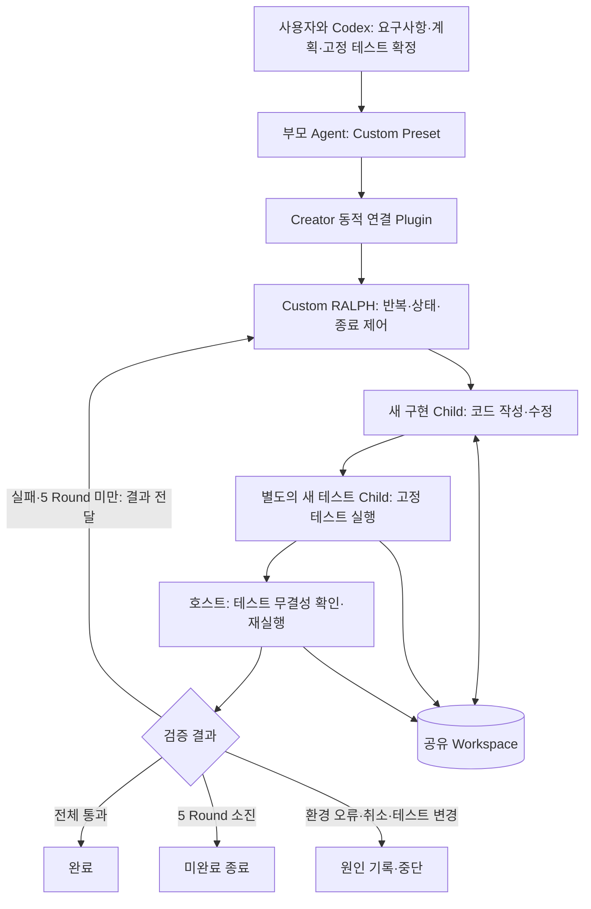

# Week 2 — 검증 기반 Coding RALPH 실행 결과

## 과제 제출 항목

| 필수 항목 | 제출 파일과 검증 근거 |
|---|---|
| 반복 제어 Plugin 코드·설정 | [반복 제어](plugin/core.mjs), [Harness 연결](plugin/index.mjs), [Preset 설정](preset/agent.cordis.yml) |
| Custom Agent Preset과 활성화 | [Preset 메타데이터](preset/preset.yml), [설치·실행 안내](runner/README.md), [실제 Creator 호출 로그](evidence/custom/logs/bootstrap.jsonl) |
| 실제 실행·종료 증거 | [Round별 결과](evidence/custom/logs/controller-result.json), [Child 실행 기록](evidence/custom/native-summary.json), [최종 테스트](evidence/custom/logs/final-acceptance.tap) |
| 공식 구현과 비교 | 아래 비교표, [공식 실행 결과](evidence/official/logs/controller-result.json), [공식 최종 코드](evidence/official/workspace/cli.mjs) |
| 최종 산출물 | [Custom이 생성한 CLI](evidence/custom/workspace/cli.mjs), [고정 계약 테스트](acceptance/todo.test.mjs) |

## Agent 구조

## 목적과 구현

grill-me 인터뷰로 요구사항·계획·테스트 기준을 먼저 확정하고, 구현 → 별도 테스트 에이전트 → 실패 피드백 → 수정의 반복을 Custom Plugin으로 구현했다. 반복 로직은 [core.mjs](plugin/core.mjs), Harness 연결은 [index.mjs](plugin/index.mjs), 실제 테스트 실행과 무결성 확인은 [host.mjs](plugin/host.mjs)에 있다. 공식 `tool-ralph`를 호출하지 않고 `ctx.subagents.start('spawn', ...)`를 직접 제어한다.

각 Round는 새 구현 Child와 새 테스트 Child를 차례로 실행한다. 공유 Workspace가 코드 상태를 보존하며, 구현 보고와 검증 결과를 다음 Child에 넘긴다. 테스트 Child의 통과 보고와 호스트의 고정 테스트 실행이 모두 성공해야 완료한다. 최대 5 Round까지 실패하면 미완료, 환경 오류·취소·테스트 변경은 완료와 구분한다.

## Preset과 Creator Mode

Custom Preset은 직접 작성한 persona·파일·셸·Custom RALPH와 Creator 도구로 구성했다. 실행 시 [동적 연결 Plugin](runner/creator.host.js)을 `cordis_define`로 정의하고 `cordis_run`으로 활성화한 다음, 등록된 `creator_run_loop`에서 Custom 컨트롤러를 호출한다. 반복 제어 자체는 파일 기반 Plugin이며, 동적 Plugin은 연결 역할이다. 설치와 재현 명령은 [실행 안내](runner/README.md)에 있다.

## 비교 조건

- 모델: `amazon-bedrock` / `us.anthropic.claude-sonnet-4-5-20250929-v1:0`.
- 작업: JSON 파일에 저장하는 Node.js TODO CLI 구현. 추가·조회·완료, 입력 검증과 오류 시 상태 보존.
- 초기 상태: CLI가 없고 동일한 acceptance 테스트만 있는 별도 Workspace.
- 동일한 [작업 지시문](runner/task.txt), 동일한 고정 테스트, 최대 5 Round.
- 최종 평가는 에이전트 보고와 별도로 외부 고정 테스트 사본을 실행한다.

공식 Preset은 `cordis`, Custom은 도구 범위를 줄인 `custom-ralph`다. 따라서 비교 대상은 반복 제어뿐 아니라 Preset 구성까지 포함한다. 최대 Round를 맞췄지만 모델 호출 수나 도구 구성을 같게 만든 실험은 아니다.

## 구현 중 발견하고 수정한 문제

1. 도구 출력 스키마가 없으면 실제 Harness 등록이 실패했다. 출력 스키마를 추가하고 Preset·Creator 로딩을 확인했다.
2. Node 테스트 안에서 다른 Node 테스트를 실행할 때 `NODE_TEST_CONTEXT`를 상속하면 재귀 실행으로 판단해 테스트를 생략했다. 실행기에서 해당 변수를 제거하고, 0개 실행을 성공으로 처리하지 않도록 했다.
3. Child의 `toolFilter`는 전역 도구만 제한했다. Preset에 등록된 `subagent`가 남아 첫 실험에서 구현 Child가 추가 에이전트를 호출했다. [수정 전 증거](evidence/custom-before-fix/native-summary.json)를 보관했다. Custom Preset에서 위임 도구를 제거하고, 최종 실행 guard로 역할별 도구를 제한했다. 이 경로는 실제 scoped 도구 회귀 테스트로 확인한다.

고정 테스트 hash는 단계 사이에 남은 변경을 감지한다. 파일을 잠깐 바꾼 뒤 복원하는 공격까지 방지하는 장치는 아니다. 테스트 명세 자체의 완전성도 보장하지 않는다.

## 최종 실행 결과

| 항목 | Custom RALPH | 공식 `tool-ralph` |
|---|---:|---:|
| 실행 Round | 1 | 1 |
| 작업 Child 수 | 구현 1 + 테스트 1 | 작업 1 |
| 최대 Child 깊이 | 1 | 1 |
| 최종 고정 테스트 | 6/6 통과 | 6/6 통과 |
| 고정 테스트 변경 | 없음 | 없음 |
| Child 도구 호출 수 | 16 | 25 |
| 전체 토큰(캐시 포함) | 119,274 | 446,516 |
| 컨트롤러 실행 시간 | 145.337초 | 106.676초 |
| 종료 이유 | 테스트 Child 통과 + 호스트 검증 통과 | 작업 Child 완료 보고; 외부 검증도 통과 |

| 설계 비교 | Custom RALPH | 공식 `tool-ralph` |
|---|---|---|
| 반복 제어 | 구현·테스트 Child를 순서대로 시작하고 고정 테스트로 다음 Round 결정 | 고정 workflow가 Round별 작업 Child 보고로 다음 Round 결정 |
| Context | 구현·테스트 각각 새 대화 | Round마다 새 대화 |
| 상태 전달 | 공유 파일 + 이전 구현·테스트·실행 결과 보고 | 공유 파일 + 제한된 구조화 Handoff |
| 오류·진행 불가 | Child 실패·환경 오류·테스트 변경은 중단, 계약 테스트 실패는 한도 내 재시도 | Child 보고가 blocked이면 종료, 비정상 Child 종료는 오류, continue이면 한도 내 재시도 |

두 실행 모두 1 Round에서 완료됐다. Custom은 별도 검증 Child와 호스트 실행에서 6개 테스트가 모두 통과했기 때문에 다음 Round를 시작하지 않았다. 실패 피드백을 다음 Round에 넘기는 경로와 5 Round 소진 경로는 자동 테스트로 확인했다. 실제 모델 실행에서 여러 Round를 거친 사례는 이번 최종 비교에 없다.

토큰은 native session의 사용량 합계다. 입력에는 일반 입력과 캐시 읽기·쓰기가 포함되며 API 비용과 같은 지표가 아니다. 시간은 `creator_run_loop` 호출부터 컨트롤러 종료까지이며 별도의 최종 외부 테스트 시간은 제외했다. 최종 Custom은 별도 위임을 호출하지 않았고 구현 Child는 `read`, `write`, `structured_output`, 테스트 Child는 `read`, `bash`, `structured_output`만 호출했다.

[Custom 실행 로그와 결과](evidence/custom/logs/controller-result.json), [공식 실행 로그와 결과](evidence/official/logs/controller-result.json), 각 `native-summary.json`과 `final-acceptance.tap`에 근거가 있다. 모델에 전달한 동일한 작업과 초기 테스트 hash는 각 `manifest.json`에서 대조할 수 있다. 원본 세션은 로컬 실행 폴더에 보관하고 제출물에는 선택한 실행 메타데이터만 포함했다.

## 결론

최종 소스 검증은 별도 서브에이전트가 실행했다. CLI 계약, 반복·상태 전달·종료·취소, 실제 테스트 실행기, 파일 무결성, Preset의 scoped 도구 제한을 포함해 **53개 통과, 실패·취소·생략 0개**다. [최종 테스트 로그](tests/final-verification.log)에 실행 결과를 보관했다. 실제 모델 실행의 최종 외부 테스트도 Custom·공식 각각 6개를 통과했다.

Custom은 구현과 검증 역할을 분리하고 실제 고정 테스트를 종료 조건으로 연결했다. 이번 단일 작업에서는 두 방식 모두 정답을 만들었고, Custom은 캐시를 포함한 처리 토큰이 적었지만 실행 시간은 더 길었다. Custom의 작은 Preset과 공식 Creator Preset의 차이도 결과에 포함되므로 반복 설계 하나의 효과나 일반적인 우열로 해석하지 않는다.

구현 과정에서는 설치 성공과 실제 동작이 달랐고, 특히 전역 도구 필터와 Preset 도구의 적용 범위 차이가 실제 우회 호출로 드러났다. 실제 호출 로그를 확인한 뒤 실행 guard와 작은 Preset으로 수정했다. 다음 실험에서는 자연스럽게 여러 Round가 필요한 작업과 동일한 도구 구성을 사용해 검증 단계 자체의 효과를 분리할 수 있다.
