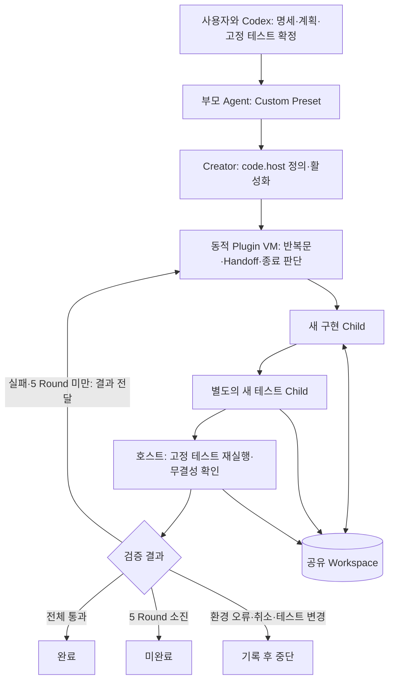
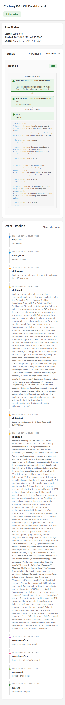

# Week 2 — Creator Mode에서 직접 제어하는 Coding RALPH

> 아래 TODO 결과와 수치는 당시의 서로 다른 Preset으로 실행한 원본 실험 기록이다. 이후 실험은 별도 문서에 정리했다.

## 세부 결과

| 문서 | 내용 |
|---|---|
| [프로젝트 플래너](result-planner.md) | Task 3·4 피드백을 반영한 더 큰 과제, 동일 Preset으로 Custom·공식 비교 |
| [세 과제 비교](result-multi-scenario.md) | 플래너·재고·CSV 장부에서 관찰된 차이와 한계 |
| [주문·재고·결제 통합](result-orders.md) | 가장 큰 통합 과제와 실행 후 추가 테스트 |
| [실시간 대시보드](#추가-실험-실시간-실행-대시보드) | 작은 모델(Haiku 4.5)로 RALPH 실행 흐름 UI 구현, 아래 섹션 |

## 필수 제출 항목

| 항목 | 제출 파일과 실제 증거 |
|---|---|
| Creator에서 실행되는 반복 제어 Plugin | [실제 제출된 전체 code.host](evidence/creator-custom/creator.host.js), [원본 반복 함수](plugin/core.mjs), [소스 생성기](runner/creator-source.mjs) |
| Custom Agent Preset | [실제 실행 Preset](evidence/creator-custom/preset/agent.cordis.yml), [메타데이터](preset/preset.yml), [재현 안내](runner/README.md) |
| 반복·상태 전달·종료 증거 | [Round별 실제 결과](evidence/creator-custom/logs/controller-result.json), [Creator 호출과 Handoff 로그](evidence/creator-custom/logs/bootstrap.jsonl), [Child 기록](evidence/creator-custom/native-summary.json) |
| 공식 비교 | [공식 2 Round 결과](evidence/creator-official/logs/controller-result.json), [각 Round의 continue·complete 보고](evidence/creator-official/native-summary.json) |
| 최종 코드·테스트 | [Custom 생성 CLI](evidence/creator-custom/workspace/cli.mjs), [공식 생성 CLI](evidence/creator-official/workspace/cli.mjs), [고정 계약 테스트](acceptance/todo.test.mjs) |

## 목적과 Agent 구조

요구사항·계획·고정 테스트를 먼저 확정하고 구현 → 독립 테스트 → 실패 피드백 → 수정을 반복하는 Coding RALPH를 만들었다. 공식 `tool-ralph`를 호출하는 래퍼나 프롬프트만으로 반복시키는 구조가 아니다.

[creator-source.mjs](runner/creator-source.mjs)는 `core.mjs`의 전체 반복 함수를 동적 Plugin 소스에 삽입한다. 그 **전체 소스**를 `cordis_define`의 `code.host`로 제출하고 `cordis_run`으로 활성화한다. 실제 `creator_run_loop` 호출 시 반복문, 이전 실패 보고 구성, 다음 Round 시작과 완료 판단이 Creator VM에서 실행된다. 제출 소스와 manifest의 SHA-256, 정의 로그를 함께 대조할 수 있다.

`ralphHost.withRun`은 Child 생성·정리, 파일 hash, 고정 테스트 실행과 취소를 제공하는 호스트 어댑터다. 호스트에는 Round 반복문이 없고 동적 callback에 이러한 기능을 제공할 뿐이다. 새 실험의 Custom Preset에는 정적 `custom_ralph` 도구를 마운트하지 않으며 bootstrap에서 이 조건을 검사한다. 파일 기반 `apply`는 기존 호환 경로와 guard 회귀 테스트를 위해 남겼다.

## 실험 조건과 단계별 작업

- 모델: `amazon-bedrock` / `us.anthropic.claude-sonnet-4-5-20250929-v1:0`.
- 작업: 추가·조회·완료 처리와 JSON 파일 저장을 지원하는 Node.js TODO CLI.
- 동일한 [단계별 작업 지시문](runner/task-staged.txt), 고정 테스트 6개, 최대 5 Round.
- 초기 Workspace는 동일한 테스트만 포함하며 CLI와 참고 구현은 없다.
- Custom은 구현·테스트 Child를 분리하고 공식은 Round별 작업 Child가 구현·테스트한다. 최종 결과는 둘 다 외부 고정 테스트 사본으로 다시 평가한다.

**의도적으로 계획한 단계별 실험**이다. Round 1에서는 추가·조회만 구현하고 `complete`를 지원하지 않는다. 전체 고정 테스트를 그대로 실행하면 완료 처리 테스트가 실제로 실패한다. Round 2는 그 실패와 기존 코드를 받아 `complete`를 구현한다. 테스트를 생략·완화하거나 실패 결과를 조작하지 않았다. 자연 발생한 버그나 어려운 작업을 자율적으로 해결한 실험으로 해석하지 않는다.

## 실제 Round 진행

| 실행 | Round 1 | 다음 Round로 전달한 상태 | Round 2와 종료 |
|---|---|---|---|
| Custom | 구현 ready → 독립 테스트 fail. 실제 5/6 통과, 호스트도 종료 코드 1 확인 | 구현 보고, 완료 처리 assertion 실패, 호스트 실행 결과. Round 2 `handoff`에 3,461자 기록 | 새 구현 Child가 완료 기능 보완 → 새 테스트 Child pass → 호스트 6/6·종료 코드 0 → complete |
| 공식 | 작업 Child가 5/6 통과와 미구현 완료 기능을 보고하고 continue | 공유 코드 + 구조화 보고의 evidence·nextSteps | 새 작업 Child가 완료 기능 보완 → 6/6·종료 코드 0을 보고하고 complete |

Custom은 각 Round의 구현·테스트에 **서로 다른 새 Session**을 사용했다. 총 네 Child의 부모는 같은 제어 Agent이고 깊이는 모두 1이다. 공식은 Round마다 새 작업 Child를 생성해 총 두 Child를 사용했다. 추가 위임이나 깊이 2의 Child는 없다. [Custom native 기록](evidence/creator-custom/native-summary.json)과 [공식 native 기록](evidence/creator-official/native-summary.json)의 `structuredReports`에도 각 Round의 실제 보고를 보관했다.

## 비교 결과

| 항목 | Creator Custom RALPH | 공식 tool-ralph |
|---|---:|---:|
| 실제 Round 수 | 2 | 2 |
| 작업 Child 수 | 구현 2 + 테스트 2 | 작업 2 |
| 최대 Child 깊이 | 1 | 1 |
| 첫 Round 테스트 | 5/6, 실제 실패 | 5/6, 실제 실패 |
| 최종 외부 고정 테스트 | 6/6 통과 | 6/6 통과 |
| 고정 테스트 변경 | 없음 | 없음 |
| Child 도구 호출 수 | 15 | 26 |
| 전체 토큰·캐시 포함 | 111,513 | 455,276 |
| 출력 토큰 | 3,813 | 5,363 |
| 호출부터 실험 종료 기록까지 | 95.716초 | 139.247초 |

| 설계 | Custom | 공식 |
|---|---|---|
| 반복 제어 위치 | Creator 동적 Plugin VM의 직접 작성한 for 루프 | 공식 고정 workflow |
| Context | 구현·테스트 각각 새 Child | Round마다 새 작업 Child |
| Handoff | 공유 파일 + 이전 구현·독립 테스트·호스트 실행 보고 | 공유 파일 + 제한된 구조화 보고 |
| 완료 기준 | 독립 테스트 pass와 실제 고정 테스트 성공을 함께 확인 | 작업 Child의 완료 보고; 최종 외부 평가를 별도 실행 |
| 실패·종료 | assertion 실패는 재시도, 환경 오류·테스트 변경·취소는 중단, 5 Round 소진은 미완료 | continue는 재시도, blocked는 종료, Child 비정상 종료는 오류, Round 한도에서 종료 |

토큰은 native session usage를 합산했다. 입력에는 일반 입력과 캐시 읽기·쓰기가 포함되며 비용과 같은 지표가 아니다. 시간은 `creator_run_loop` 시작부터 `experiment/end` 기록까지로 최종 외부 테스트 시간은 제외한다. Custom은 작은 전용 Preset, 공식은 `cordis` Preset을 사용하므로 토큰·시간 차이를 반복 제어 하나의 효과로 단정할 수 없다. 두 실행은 독립 폴더에서 비슷한 시기에 실행했으며 단일 비교다.

## 검증과 수정 이력

별도 서브에이전트가 계약·반복·상태 전달·5 Round 한도·실패·취소·파일 무결성·실제 scoped guard에 더해 **생성된 Creator 소스 자체를 VM에서 실행하는 테스트**를 수행했다. [61개 전체 통과 로그](tests/creator-revision-verification.log)와 [독립 검증](tests/creator-revision-validation.md)에 근거가 있다. 실제 모델 실험도 Custom·공식 각각 최종 외부 테스트 6개를 통과했다.

처음에는 Creator에 등록한 연결 Plugin이 파일 기반 컨트롤러를 호출했고 실제 작업은 1 Round에서 끝났다. 과제 의도를 더 명확히 충족하도록 반복 함수 자체를 Creator VM으로 옮기고 위 2 Round 실험을 추가했다. 초기 [Custom 1 Round 결과](evidence/custom/logs/controller-result.json)와 [공식 1 Round 결과](evidence/official/logs/controller-result.json)는 이력으로 보관했다.

구현 중에는 출력 스키마 누락에 따른 실제 등록 실패, 중첩 Node 테스트의 `NODE_TEST_CONTEXT` 상속에 따른 실행 생략, 전역 `toolFilter`가 Preset 도구를 제한하지 못하는 문제를 수정했다. 마지막 문제의 [수정 전 기록](evidence/custom-before-fix/native-summary.json)을 보관했고, 실행 guard와 위임 도구를 제거한 작은 Preset을 적용했다. 각 문제의 회귀 테스트도 유지한다.

## 추가 실험: 실시간 실행 대시보드

더 크고 어려운 과제로 RALPH 자체의 실행 흐름을 보여주는 웹 대시보드를 Custom RALPH에 맡겼다. 어느 Child가 무엇을 끝냈고 무엇이 부족했는지, 어떤 테스트를 돌렸고 결과가 어땠는지, 다음 Round로 무엇을 넘겼는지를 SSE로 받아 새로고침 없이 보여줘야 한다. 하네스가 실수를 잡는지 보기 위해 모델은 Bedrock Claude Haiku 4.5를 썼다. 앱 코드는 모두 Child가 작성했고 수동으로 고치지 않았다.

| 실행 | 변경 | 컨트롤러 | 호스트 테스트 |
|---|---|---|---|
| [`first`](evidence/live-ui-haiku-first/logs/controller-result.json) | 첫 구현 | `complete` | 8/9, 실행 후 추가 테스트에서 이벤트 순서 결함 |
| [`repair`](evidence/live-ui-haiku-repair/logs/controller-result.json) | 순서 결함 수정 | `complete` | 10/10, 브라우저에서 HTML 삽입 결함 |
| [`hardening`](evidence/live-ui-haiku-hardening/logs/controller-result.json) | HTML 삽입 수정, 단계 연결 화면 | `complete` | 12/12 |
| [`layout`](evidence/live-ui-haiku-layout/logs/controller-result.json) | 파일 교체·가로 넘침 수정 | `complete` | 15/15, 모바일 가독성 문제 |
| [`readability-blocked`](evidence/live-ui-haiku-readability-blocked/logs/controller-result.json) | 모바일 세로 배치, 접히는 보고서 | `blocked` | 16/16, 테스트 Child가 `structured_output` 미제출 |
| [`final`](evidence/live-ui-haiku-final/logs/controller-result.json) | 코드 변경 없이 재검증 | `complete` | 16/16 |
| [`test-details`](evidence/live-ui-haiku-test-details/logs/controller-result.json) | 호스트 단계에 실제 TAP 결과 표시, 나중에 생성된 이벤트 파일 추적 | `complete` | 19/19 |

모든 실행이 1 Round에 끝났다. 결함은 수정 Round가 아니라 테스트를 추가할 때 드러났다. `first`는 고정 테스트를 통과해 `complete`였지만 실행 후 추가 테스트 하나가 실패했다. 이후에도 실제 브라우저나 모바일 화면을 확인할 때마다 새 결함이 나왔고, 결함을 재현하는 테스트를 고정해 다시 실행하면 Haiku가 한 Round 안에 고쳤다. 하네스는 고정 테스트가 보는 범위까지만 완료를 보장한다. `readability-blocked`에서는 앱이 모든 테스트를 통과했지만 테스트 Child가 정해진 형식으로 결과를 제출하지 않아 컨트롤러가 통과로 처리하지 않았다.

- 최종 앱과 실행 방법: [`live-ui/`](live-ui/README.md)
- 계약과 고정 테스트: [`live-ui.md`](acceptance/live-ui.md), [`live-ui.test.mjs`](acceptance/live-ui.test.mjs), [`live-ui.browser.test.mjs`](acceptance/live-ui.browser.test.mjs), 실행 후 추가 테스트 [`live-ui-heldout.test.mjs`](acceptance/live-ui-heldout.test.mjs)
- 실행별 과제와 증거: `runner/task-live-ui*.txt`, `evidence/live-ui-haiku-*/` (컨트롤러 결과, TAP, 이벤트 로그, 생성 코드)

## 결론과 한계

이번 보완으로 Creator에 제출된 소스에서 반복 제어가 직접 실행되고, 실제 테스트 실패 → 상태 전달 → 다음 Round 수정 → 검증 통과를 확인했다. 사용자에게 명세를 확정받은 뒤 구현·검증 반복을 자동화하는 목적에 맞는 구조다.

현재 hash 검사는 단계 사이에 남은 테스트 변경을 감지한다. 잠깐 수정했다 복원하는 공격이나 테스트 명세 자체의 누락까지 보장하지 않는다. 이번 단계별 실험은 Handoff와 반복 제어의 실행 증거이며, 자연스러운 실패 복구 성공률이나 일반적인 성능 우위를 증명하지 않는다. 다음에는 같은 도구 구성과 여러 자연 발생 실패 작업으로 반복 실험할 수 있다.
